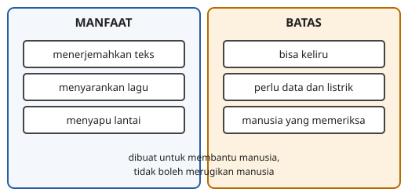

# Manfaat KA dalam Kehidupan Sehari-hari

**Ingat dulu:** Tanpa melihat catatan, tulis satu ciri mesin cerdas.

**Contoh:** Penerjemah teks. Manfaat: membantu memahami bahasa lain. Batas: bisa keliru, jadi diperiksa orang.

`[Gambar: dua kolom, manfaat dan batas. Manfaat: menerjemahkan teks, menyarankan lagu, menyapu lantai. Batas: bisa keliru, perlu data dan listrik, manusia yang memeriksa.]`

**Bandingkan:**

| | Penerjemah teks | Penyaran lagu |
| --- | --- | --- |
| Yang terbantu | pembaca | pendengar |
| Yang bisa salah | arti kata | ______ |

Apa yang sama? Apa yang beda? ______

**Coba:** Robot penyapu.

| KA | Manfaat | Batas | Yang memeriksa |
| --- | --- | --- | --- |
| robot penyapu | menghemat tenaga | ______ | ______ |

Sekarang sendiri: pilih satu KA yang kamu kenal.

| KA | Manfaat | Batas | Yang memeriksa |
| --- | --- | --- | --- |
| | | | |

Lengkapi: KA tidak boleh merugikan manusia karena ______.

**Ceritakan** ke temanmu satu manfaat dan satu batas KA.

**Catatan cetak (untuk guru, tidak dicetak):** satu lembar per murid, kertas A4. Lembar tidak memuat kolom nama, kelompok, tanggal, atau nilai; penandaan kertas diurus guru di sekolah.
