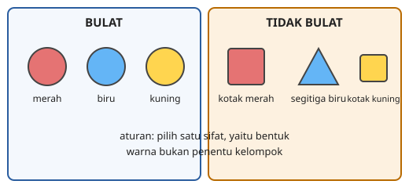

**Ingat dulu:** Tanpa melihat catatan, tulis satu manfaat KA dan satu batasnya.

**Contoh:** Enam kartu dikelompokkan menurut bentuk: bulat dan tidak bulat.

`[Gambar: dua kelompok. Bulat berisi lingkaran merah, biru, kuning. Tidak bulat berisi kotak merah, segitiga biru, kotak kuning.]`

**Bandingkan:** kartu yang sama dikelompokkan menurut warna.

| Menurut bentuk | Menurut warna |
| --- | --- |
| bulat: 3 kartu | merah: 2 kartu |
| tidak bulat: 3 kartu | biru: ______ kartu |

Apa yang sama? Apa yang beda? ______

**Coba:** Pola: merah, biru, merah, biru, ______.

Sekarang sendiri: kelompokkan lima benda di mejamu menurut satu sifat.

| Benda | Sifat yang kupakai | Kelompok |
| --- | --- | --- |
| | | |
| | | |

Tulis aturanmu dalam satu kalimat: ______

**Ceritakan** ke temanmu mengapa kita menyebut sifat yang dipakai sebelum mengelompokkan.

**Catatan cetak (untuk guru, tidak dicetak):** satu lembar per murid, kertas A4. Lembar tidak memuat kolom nama, kelompok, tanggal, atau nilai; penandaan kertas diurus guru di sekolah.
