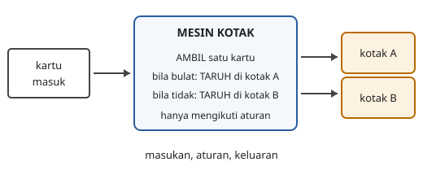

# Mengenali Pola dan Klasifikasi oleh KA

**Ingat dulu:** Tanpa melihat catatan, tulis satu aturan yang memisahkan dua benda.

**Contoh:** Mesin kotak: AMBIL satu kartu. Bila bulat, TARUH di kotak A. Bila tidak bulat, TARUH di kotak B.

`[Gambar: kartu masuk ke mesin kotak yang berisi aturan, lalu keluar ke kotak A atau kotak B.]`

**Bandingkan:** Aturan 2: bila bulat dan merah, TARUH di kotak A. Bila kotak, TARUH di kotak B.

| Kartu | Aturan 1 | Aturan 2 |
| --- | --- | --- |
| lingkaran merah | A | A |
| kotak merah | B | B |
| segitiga biru | B | tidak ada tempat |

Apa yang sama? Apa yang beda? ______

**Coba:** Kartu lingkaran biru pada Aturan 2. Masuk kotak mana? ______

Perbaiki Aturan 2 supaya semua kartu punya tempat: ______

Sekarang sendiri: tulis aturan mesin kotakmu untuk dua kotak.

AMBIL satu kartu. Bila ______, TARUH di kotak A. Bila tidak, TARUH di kotak B.

Uji aturanmu pada tiga kartu. Ada yang tidak punya tempat? ______

**Ceritakan** ke temanmu mengapa mesin tidak boleh menebak di luar aturannya.

**Catatan cetak (untuk guru, tidak dicetak):** satu lembar per murid, kertas A4. Lembar tidak memuat kolom nama, kelompok, tanggal, atau nilai; penandaan kertas diurus guru di sekolah.
