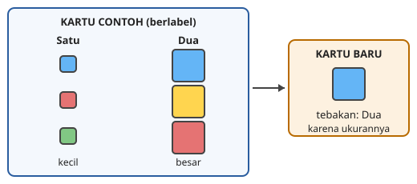

**Ingat dulu:** Tanpa melihat catatan, tulis apa yang dilakukan mesin kotak bila kartu tidak cocok dengan aturan mana pun.

**Contoh:** Kartu baru besar biru. Tebakan: Dua, karena semua kartu besar di contoh berlabel Dua.

`[Gambar: kiri, kartu contoh berlabel. Satu berisi tiga kartu kecil, Dua berisi tiga kartu besar. Kanan, kartu baru besar dengan tebakan Dua.]`

**Bandingkan:**

| | Tebakan lewat warna | Tebakan lewat ukuran |
| --- | --- | --- |
| Kartu baru besar biru | tidak yakin | Dua |
| Cocok dengan semua contoh? | tidak | ya |

Apa yang sama? Apa yang beda? ______

**Coba:** Kartu baru kecil kuning. Tebakan: ______, karena ______.

Sekarang sendiri: kartu baru berukuran sedang, berwarna hijau.

| Tebakanku | Yakin atau ragu | Alasanku |
| --- | --- | --- |
| | | |

Mengapa kartu baru yang berbeda bisa menghasilkan tebakan yang berbeda? ______

**Ceritakan** ke temanmu sifat mana yang kamu percaya dari contoh, dan mengapa.

**Catatan cetak (untuk guru, tidak dicetak):** satu lembar per murid, kertas A4. Lembar tidak memuat kolom nama, kelompok, tanggal, atau nilai; penandaan kertas diurus guru di sekolah.
