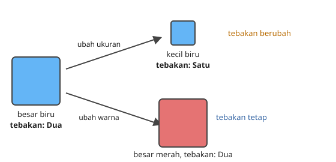

# Pengaruh Data Input terhadap Hasil Mengenali Pola dan Klasifikasi KA

**Ingat dulu:** Tanpa melihat catatan, tulis apa yang kamu pakai untuk menebak kelompok kartu baru.

**Contoh:** Kartu besar biru. Tebakan: Dua. Ubah ukuran menjadi kecil, tebakan berubah menjadi Satu.

`[Gambar: kartu besar biru bertebakan Dua. Panah ubah ukuran menuju kartu kecil biru bertebakan Satu. Panah ubah warna menuju kartu besar merah yang tetap bertebakan Dua.]`

**Bandingkan:** kartu besar biru yang sama, sifat yang diubah berbeda.

| Yang diubah | Kartu baru | Tebakan | Berubah? |
| --- | --- | --- | --- |
| ukuran | kecil biru | Satu | ya |
| warna | besar merah | Dua | tidak |

Apa yang sama? Apa yang beda? ______

**Coba:** Kartu besar kuning. Ubah warnanya menjadi hijau. Tebakan: ______

Sekarang sendiri: mulai dari kartu kecil merah.

| Aku mengubah | Kartu baru | Tebakan | Berubah? |
| --- | --- | --- | --- |
| | | | |
| | | | |

Sifat mana yang membuat tebakan berubah? ______

**Ceritakan** ke temanmu mengapa dua kartu yang hampir sama bisa mendapat tebakan berbeda.

**Catatan cetak (untuk guru, tidak dicetak):** satu lembar per murid, kertas A4. Lembar tidak memuat kolom nama, kelompok, tanggal, atau nilai; penandaan kertas diurus guru di sekolah.
