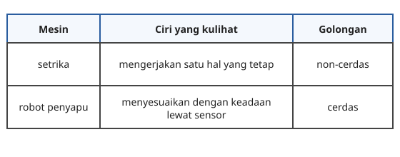

**Ingat dulu:** Tanpa melihat catatan, tulis dua ciri mesin cerdas dan satu mesin non-cerdas di rumah.

**Contoh:** Dua baris sudah terisi.

`[Gambar: tabel dua baris. Setrika, ciri satu hal yang tetap, non-cerdas. Robot penyapu, ciri menyesuaikan dengan keadaan, cerdas.]`

**Bandingkan:** dua rumah fiktif.

| Rumah A | Rumah B |
| --- | --- |
| kipas | lampu meja |
| robot penyapu | lampu sensor gerak |

Apa yang sama? Apa yang beda? ______

**Coba:** Kipas di Rumah A. Ciri: ______ Golongan: ______

Sekarang sendiri: isi dari ingatanmu, atau pakai mesin di sekolah.

| Mesin | Ciri yang kulihat | Cerdas atau non-cerdas |
| --- | --- | --- |
| | | |
| | | |
| | | |
| | | |

Satu baris boleh kamu isi "belum tahu". Bila kamu mau, tanyakan di rumah: "Apa alat ini bekerja sama saja, atau menyesuaikan dengan keadaan?"

Tulis hanya jenis mesin. Jangan menulis nama orang atau alamat.

**Ceritakan** ke temanmu satu mesin yang sulit kamu golongkan, dan ciri apa yang masih perlu dicari.

**Catatan cetak (untuk guru, tidak dicetak):** satu lembar per murid, kertas A4. Lembar tidak memuat kolom nama, kelompok, tanggal, atau nilai; penandaan kertas diurus guru di sekolah.
