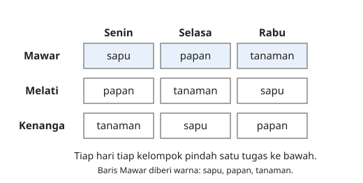

**Ingat dulu:** Tanpa melihat catatan, tulis empat langkah memecahkan masalah.

**Contoh:** Tiga kelompok, tiga tugas: sapu, papan, tanaman. Setiap hari kelompok pindah satu tugas ke bawah.

`[Gambar: tabel tiga baris dan tiga kolom. Baris Mawar, Melati, Kenanga; kolom Senin, Selasa, Rabu. Mawar: sapu, papan, tanaman. Panah menurun menunjukkan tiap kelompok pindah satu tugas ke bawah.]`

**Bandingkan:**

| Algoritma P | Algoritma Q |
| --- | --- |
| 1. Tulis tiga tugas. 2. Senin, tiap kelompok ambil satu tugas. 3. Hari berikutnya pindah satu tugas ke bawah. 4. Periksa. | 1. Bagi tugas dengan adil. 2. Atur giliran. 3. Selesai. |

Apa yang sama? Apa yang beda? ______

**Coba:** Sekarang pindah satu tugas ke atas. Kelompok di tugas pertama pindah ke tugas terakhir.

| | Senin | Selasa | Rabu |
| --- | --- | --- | --- |
| Mawar | sapu | ______ | ______ |
| Melati | papan | ______ | ______ |
| Kenanga | tanaman | ______ | ______ |

Sekarang sendiri: tulis algoritma 3 sampai 5 langkah untuk jadwal piket empat kelompok selama lima hari, satu kelompok tiap hari.

1. ______
2. ______
3. ______

Minta temanmu menjalankannya. Apakah ia perlu menebak? ______

**Ceritakan** ke temanmu mengapa "bagi dengan adil" belum cukup.

**Catatan cetak (untuk guru, tidak dicetak):** satu lembar per murid, kertas A4. Lembar tidak memuat kolom nama, kelompok, tanggal, atau nilai; penandaan kertas diurus guru di sekolah.
