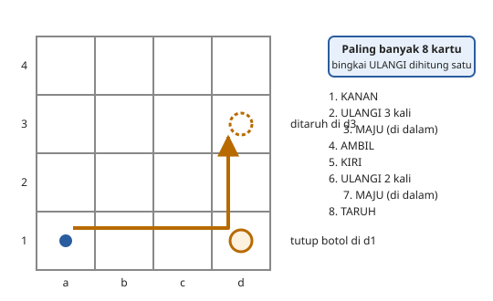

**Ingat dulu:** Tanpa melihat catatan, tulis apa yang kamu tulis sebelum menjalankan instruksi supaya bisa dicocokkan dengan hasilnya.

**Contoh:** Tantangan 1: tutup botol di d1, pindahkan ke d3, paling banyak 8 kartu. Jawaban: KANAN, ULANGI 3 kali [MAJU], AMBIL, KIRI, ULANGI 2 kali [MAJU], TARUH.

`[Gambar: kisi 4x4. Tutup botol berada di d1. Jalur dari a1 ke kanan sampai d1, lalu naik sampai d3, tempat tutup botol ditaruh.]`

**Bandingkan:**

| | Jawaban A | Jawaban B |
| --- | --- | --- |
| Kartu | KANAN, MAJU 3x, AMBIL, KIRI, MAJU 2x, TARUH | jawaban di atas |
| Banyak kartu | 9 | ______ |
| Memenuhi batas 8? | tidak | ______ |

Apa yang sama? Apa yang beda? ______

**Coba:** Tantangan 2: tutup botol di a3, ke d3, paling banyak 7 kartu. MAJU, MAJU, AMBIL, KANAN, ______ , TARUH

Sekarang sendiri: tantangan 3: tutup botol di a2, ke c2, paling banyak 6 kartu. Boleh di kartu kertas atau di layar sekolah bila guru menyediakan; isinya sama.

______

Buat tantanganmu sendiri untuk temanmu:

| Benda di | Pindahkan ke | Paling banyak (kartu) |
| --- | --- | --- |
| ______ | ______ | ______ |

Simpan jawabanmu di balik kertas, lalu tukar. Selesai dan sesuai batas? ______

**Ceritakan** ke temanmu bagaimana kamu memeriksa tantangan temanmu.

**Catatan cetak (untuk guru, tidak dicetak):** satu lembar per murid, kertas A4; kartu blok disiapkan guru. Lembar tidak memuat kolom nama, kelompok, tanggal, atau nilai; penandaan kertas diurus guru di sekolah.
