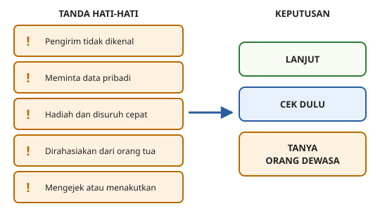

**Ingat dulu:** Tanpa melihat catatan, tulis satu tanda pesan yang perlu ditanyakan dulu kepada orang dewasa.

**Contoh:** Kasus 1. Pesan dari orang tidak dikenal: "Kamu menang tablet! Isi nama lengkap dan sekolahmu sekarang!" Tanda: pengirim tidak dikenal, hadiah, disuruh cepat, minta data pribadi. Keputusan: TANYA ORANG DEWASA.

`[Gambar: lima kotak tanda hati-hati di kiri, tanda seru di tiap kotak. Di kanan tiga kotak keputusan: LANJUT, CEK DULU, TANYA ORANG DEWASA.]`

**Bandingkan:** Kasus 2: Kak Dina, kakak kelas yang dikenal guru, menulis di grup kelas fiktif, "Besok bawa penggaris, ya."

| | Kasus 1 | Kasus 2 |
| --- | --- | --- |
| Pengirim dikenal? | tidak | ya |
| Meminta data pribadi? | ya | ______ |
| Menyuruh cepat-cepat? | ya | ______ |
| Keputusan | tanya orang dewasa | ______ |

Apa yang sama? Apa yang beda? ______

**Coba:** Kasus 3: halaman permainan fiktif meminta tanggal lahir untuk "hadiah ulang tahun". Tanda: ______ Keputusan: ______

Sekarang sendiri:

| Kasus | Tanda yang ada | Keputusan | Alasan |
| --- | --- | --- | --- |
| 4. Orang tidak dikenal minta percakapan dirahasiakan dari orang tua | | | |
| 5. Pesan di grup kelas fiktif mengejek Dewi | | | |
| 6. Halaman perpustakaan fiktif, ada penulis dan tanggal, tanpa permintaan data | | | |

**Ceritakan** ke temanmu mengapa "tanya orang dewasa" adalah keputusan yang kuat.

**Catatan cetak (untuk guru, tidak dicetak):** satu lembar per murid, kertas A4. Lembar tidak memuat kolom nama, kelompok, tanggal, atau nilai; penandaan kertas diurus guru di sekolah.
