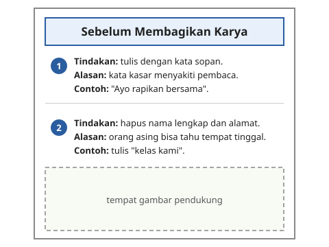

**Ingat dulu:** Tanpa melihat catatan, tulis tiga pertanyaan pemeriksa konten.

**Contoh:** Panduan "Sebelum Membagikan Karya". Aturan 1: Tulis dengan kata sopan, karena kata kasar menyakiti pembaca. Contoh: "Ayo rapikan bersama" bukan "Kamu pemalas".

`[Gambar: satu lembar panduan dengan judul. Di bawahnya dua aturan bernomor, masing-masing punya tiga baris berlabel tindakan, alasan, dan contoh.]`

**Bandingkan:**

- Panduan A: "Jangan jahat. Hati-hati."
- Panduan B: aturan bernomor dengan tindakan, alasan, dan contoh.

Apa yang sama? Apa yang beda? Panduan mana yang bisa dijalankan temanmu tanpa bertanya? ______

**Coba:** Aturan 3 tentang isi yang benar.

| Tindakan | Alasan | Contoh |
| --- | --- | --- |
| Cek dulu isi tulisanmu ke sumber atau orang dewasa. | ______ | ______ |

Sekarang sendiri: tulis dua aturan lagi untuk teman satu sekolah.

| Tindakan | Alasan | Contoh |
| --- | --- | --- |
| | | |
| | | |

Tukar dengan kelompok lain. Aturan mana yang belum jelas? ______

**Ceritakan** ke temanmu satu aturan yang paling berguna.

**Catatan cetak (untuk guru, tidak dicetak):** satu lembar per murid atau per kelompok, kertas A4. Lembar tidak memuat kolom nama, kelompok, tanggal, atau nilai; penandaan kertas diurus guru di sekolah.
