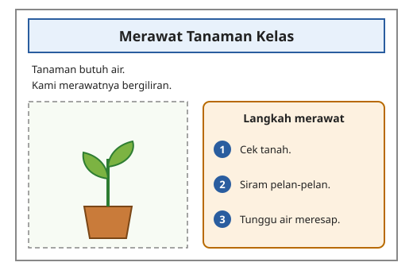

**Ingat dulu:** Tanpa melihat catatan, tulis bagaimana kamu membagikan karya di kelas tanpa mengunggahnya ke internet.

**Contoh:** Lembar buletin "Merawat Tanaman Kelas": judul, dua kalimat, satu gambar, dan kotak langkah: 1. Cek tanah. 2. Siram pelan-pelan. 3. Tunggu air meresap.

`[Gambar: lembar buletin dengan kotak judul di atas, dua garis teks, satu gambar tanaman di kiri, dan kotak langkah bernomor satu sampai tiga di kanan.]`

**Bandingkan:**

| | Media A | Media B |
| --- | --- | --- |
| Judul | ada | tidak ada |
| Teks | pendek | panjang dan padat |
| Langkah bernomor | ada | ______ |
| Data pribadi | tidak ada | ada |

Apa yang sama? Apa yang beda? ______

**Coba:** Tema merawat tanaman. Lengkapi.

| Judul | Satu kalimat | Satu gambar |
| --- | --- | --- |
| Merawat Tanaman Kelas | Tanaman butuh air. | ______ |

Sekarang sendiri, bersama kelompokmu: pilih satu tema (aman memakai internet, dampak teknologi digital, atau konten positif). Buat poster atau lembar buletin dengan judul, teks, satu gambar, dan kotak langkah.

Langkah 1: ______ Langkah 2: ______ Langkah 3: ______

Periksa: sopan? benar? tanpa data pribadi? satu tindakan tiap langkah? ya / belum.

**Ceritakan** ke temanmu satu langkah di mediamu dan mengapa urutannya begitu.

**Catatan cetak (untuk guru, tidak dicetak):** satu lembar per murid atau per kelompok, kertas A4 untuk kerangka; media jadi dibuat di kertas poster atau A4. Lembar tidak memuat kolom nama, kelompok, tanggal, atau nilai; penandaan kertas diurus guru di sekolah.
