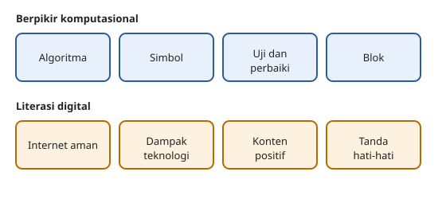

**Ingat dulu:** Tanpa melihat catatan, tulis satu hal dari tiap kelompok: berpikir komputasional dan literasi digital.

**Contoh:** Latihan bentuk soal dengan jawaban lengkap: memilih buah.

`[Gambar: dua baris. Baris pertama berpikir komputasional: algoritma, simbol, uji dan perbaiki, blok. Baris kedua literasi digital: internet aman, dampak teknologi, konten positif, tanda hati-hati.]`

Soal: apel, jeruk, pisang. Mana yang kulitnya kuning? Jawaban: pisang, karena kulitnya kuning.

**Bandingkan:**

- Jawaban A: "pisang."
- Jawaban B: "pisang, karena kulitnya kuning."

Apa yang sama? Apa yang beda? Mana yang memuat alasan? ______

**Coba:** Soal: kartu A, B, C. Pilih yang tidak boleh dibagikan di internet: A warna kesukaan, B alamat rumah, C nama hewan peliharaan. Jawaban: ______, karena ______.

Sekarang sendiri: tulis tiga langkah satu tugas kelas, misalnya menghapus papan tulis.

| Langkah | Tulisanmu |
| --- | --- |
| 1 | |
| 2 | |
| 3 | |

Satu langkah untuk memeriksa hasilnya: ______

**Refleksi:** Tulis satu hal yang paling berguna dan satu hal yang mau dipelajari lagi.

______

**Ceritakan** ke temanmu satu hal yang kamu pelajari semester ini.

**Catatan cetak (untuk guru, tidak dicetak):** satu lembar per murid, kertas A4. Lembar ini latihan bentuk soal, bukan kuis sumatif; guru menyusun kuis sendiri. Lembar tidak memuat kolom nama, kelompok, tanggal, atau nilai; penandaan kertas diurus guru di sekolah.
