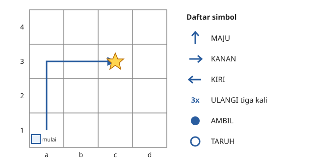

**Ingat dulu:** Tanpa melihat catatan, tulis satu ciri algoritma yang baik.

**Contoh:** Mesin mulai di a1 menghadap atas. Daftar simbol: ↑ MAJU, → KANAN, ← KIRI, 3x ULANGI tiga kali.

`[Gambar: kisi 4x4 dengan daftar simbol di samping. Panah dari a1 naik ke a3, belok kanan, lalu maju ke b3 dan c3, tempat bintang.]`

Program: ↑ ↑ → ↑ ↑. Berakhir di c3.

**Bandingkan:** program ■ ▲ ▲ dengan dua daftar simbol.

| | Daftar A | Daftar B |
| --- | --- | --- |
| ■ berarti | KANAN | MAJU |
| ▲ berarti | MAJU | KANAN |
| Berakhir di | c1 | ______ |

Apa yang sama? Apa yang beda? ______

**Coba:** Tujuan b3 dari a1. ↑ ↑ → ______

Baca: → 3x↑ ← ↑ berakhir di ______

Sekarang sendiri: tujuan d3 dari a1. Tulis programmu dengan simbol dan satu 3x.

______

Tukar dengan temanmu. Berakhir di d3? ______

**Ceritakan** ke temanmu mengapa daftar simbol harus ditulis lebih dulu.

**Catatan cetak (untuk guru, tidak dicetak):** satu lembar per murid, kertas A4. Lembar tidak memuat kolom nama, kelompok, tanggal, atau nilai; penandaan kertas diurus guru di sekolah.
