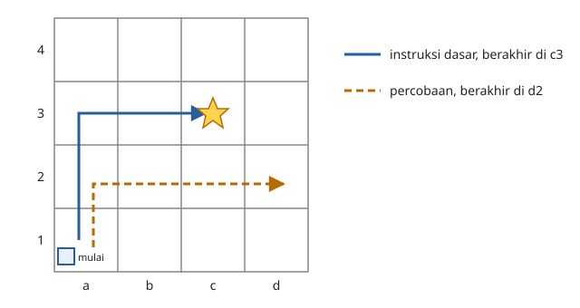

**Ingat dulu:** Tanpa melihat catatan, tulis apa yang kamu cek sebelum instruksi simbol dijalankan.

**Contoh:** Instruksi dasar: ↑ ↑ → ↑ ↑ berakhir di c3. Satu percobaan: tukar simbol kedua dan ketiga.

`[Gambar: kisi 4x4 dengan dua jalur dari a1. Jalur biru berakhir di c3. Jalur oranye, hasil percobaan, berakhir di d2.]`

| Instruksi | Tebakan | Hasil | Sama? |
| --- | --- | --- | --- |
| ↑ → ↑ ↑ ↑ | d2 | d2 | ya |

**Bandingkan:**

| | Percobaan A | Percobaan B |
| --- | --- | --- |
| Yang diubah | satu simbol | dua simbol |
| Instruksi | ↑ ↑ → ↑ ← | ↑ → → ↑ ← |
| Berakhir di | b3 | ______ |

Apa yang sama? Apa yang beda? ______

**Coba:** Dasar ↑ → ↑ ↑ berakhir di c2. Tambah satu ↑ di akhir. Tebakan: ______

Sekarang sendiri: dasar ↑ ↑ → ↑ berakhir di b3. Mesin keluar kisi berhenti.

| Aku mengubah | Instruksi | Tebakan | Hasil |
| --- | --- | --- | --- |
| | | | |
| | | | |
| | | | |

Pola apa yang kamu temukan? ______

**Ceritakan** ke temanmu mengapa tebakan ditulis sebelum menjalankan.

**Catatan cetak (untuk guru, tidak dicetak):** satu lembar per murid, kertas A4. Lembar tidak memuat kolom nama, kelompok, tanggal, atau nilai; penandaan kertas diurus guru di sekolah.
