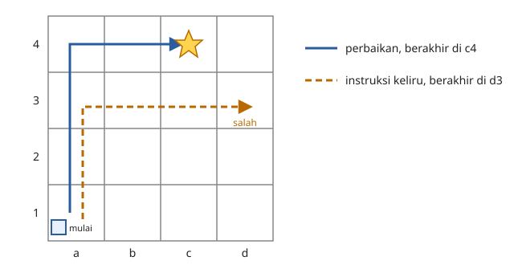

**Ingat dulu:** Tanpa melihat catatan, tulis satu ciri algoritma yang baik dan satu langkah yang memeriksa hasilnya.

**Contoh:** Tujuan c4 dari a1. Instruksi kelompok: ↑ ↑ → ↑ ↑ ↑. Mesin berakhir di d3.

`[Gambar: kisi 4x4. Jalur oranye dari a1 naik ke a3, belok kanan, berakhir di d3. Jalur biru dari a1 naik ke a4, belok kanan, berakhir di c4, tempat bintang.]`

Catatan: berakhir di d3, tujuan c4. Setelah simbol kedua mesin di a3, seharusnya a4. Perbaikan: ↑ ↑ ↑ → ↑ ↑.

**Bandingkan:**

| Catatan A | Catatan B |
| --- | --- |
| Salah. | Berakhir di d3, tujuan c4. Letak: sebelum →. Perbaikan: pindahkan satu ↑. |

Apa yang sama? Apa yang beda? ______

**Coba:** Tujuan d2. Instruksi teman: ↑ → ↑ ↑

| Berakhir di | Kurangnya | Perbaikan |
| --- | --- | --- |
| ______ | ______ | ______ |

Sekarang sendiri: tujuan c3. Instruksi teman: ↑ ↑ ← ↑ ↑

| Yang terjadi | Letak kesalahan | Perbaikan |
| --- | --- | --- |
| ______ | ______ | ______ |

Jalankan perbaikanmu. Berakhir di c3? ______

**Ceritakan** ke temanmu satu hal pada catatan yang membantu memperbaiki instruksi.

**Catatan cetak (untuk guru, tidak dicetak):** satu lembar per murid, kertas A4. Lembar tidak memuat kolom nama, kelompok, tanggal, atau nilai; penandaan kertas diurus guru di sekolah.
