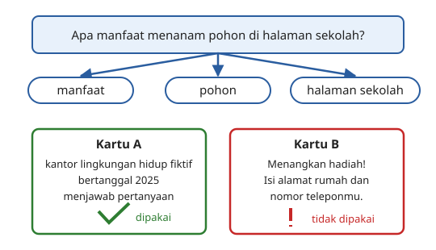

**Ingat dulu:** Tanpa melihat catatan, tulis tiga informasi yang tidak boleh dibagikan di internet dan satu alasannya.

**Contoh:** Pertanyaan: "Apa manfaat menanam pohon di halaman sekolah?" Kata kunci: manfaat, pohon, halaman sekolah.

`[Gambar: kotak pertanyaan dengan panah ke tiga kata kunci. Di bawahnya dua kartu hasil: kartu A dengan tanda centang dan kartu B dengan tanda seru.]`

**Bandingkan:** Kartu A dari kantor lingkungan hidup fiktif, bertanggal 2025. Kartu B: "Menangkan hadiah! Isi alamat rumah dan nomor teleponmu."

| | Kartu A | Kartu B |
| --- | --- | --- |
| Penulisnya jelas? | ya | tidak |
| Menjawab pertanyaan? | ya | tidak |
| Meminta data pribadi? | tidak | ya |
| Keputusan | dipakai | ______ |

Apa yang sama? Apa yang beda? ______

**Coba:** Kartu C: tanpa penulis dan tanggal, isinya menjawab sebagian. Keputusan: ______

Sekarang sendiri: pertanyaan "Bagaimana cara merawat tanaman di kelas?"

Kata kunci: ______ ______ ______

| Kartu | Keputusan | Alasan |
| --- | --- | --- |
| 1 perpustakaan sekolah, bertanggal, tanpa data pribadi | ______ | ______ |
| 2 iklan, minta nomor telepon | ______ | ______ |
| 3 tanpa penulis dan tanggal | ______ | ______ |

**Ceritakan** ke temanmu satu tanda halaman yang tidak boleh diisi datanya.

**Catatan cetak (untuk guru, tidak dicetak):** satu lembar per murid, kertas A4. Lembar tidak memuat kolom nama, kelompok, tanggal, atau nilai; penandaan kertas diurus guru di sekolah.
