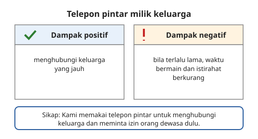

**Ingat dulu:** Tanpa melihat catatan, tulis satu teknologi digital di sekitarmu dan satu manfaatnya.

**Contoh:** Telepon pintar milik keluarga.

`[Gambar: tabel dua kolom. Kolom kiri dampak positif dengan tanda centang, kolom kanan dampak negatif dengan tanda seru. Di bawahnya satu kalimat sikap.]`

| Dampak positif | Dampak negatif |
| --- | --- |
| menghubungi keluarga yang jauh | bila terlalu lama, waktu bermain dan istirahat berkurang |

Sikap: "Kami memakai telepon pintar untuk menghubungi keluarga dan meminta izin orang dewasa dulu."

**Bandingkan:**

| | Video belajar | Permainan daring |
| --- | --- | --- |
| Positif | bagian yang belum paham bisa diputar ulang | menyenangkan, bisa bersama teman |
| Negatif | bisa menonton tanpa mencoba sendiri | mudah lupa waktu |

Apa yang sama? Apa yang beda? ______

**Coba:** Peta digital.

| Dampak positif | Dampak negatif |
| --- | --- |
| membantu menemukan jalan | ______ |

Sekarang sendiri: pilih satu: pesan singkat, kamera digital, atau pemutar musik digital.

| Dampak positif | Dampak negatif |
| --- | --- |
| 1. ______ | 1. ______ |
| 2. ______ | 2. ______ |

Sikap kelompok: Kami akan ______ supaya ______.

**Ceritakan** ke temanmu mengapa dampaknya bisa dua-duanya.

**Catatan cetak (untuk guru, tidak dicetak):** satu lembar per murid, kertas A4. Lembar tidak memuat kolom nama, kelompok, tanggal, atau nilai; penandaan kertas diurus guru di sekolah.
