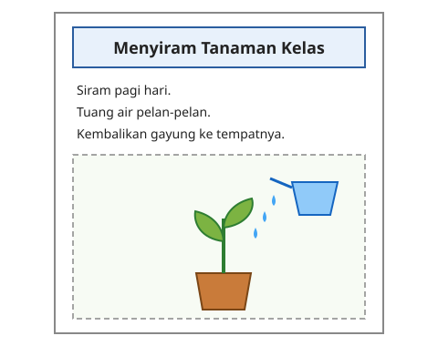

**Ingat dulu:** Tanpa melihat catatan, tulis tiga hal yang kamu cek sebelum poster dibagikan di kelas.

**Contoh:** Judul: Menyiram Tanaman Kelas. Teks: "Siram pagi hari. Tuang air pelan-pelan. Kembalikan gayung ke tempatnya."

`[Gambar: lembar dengan kotak judul di atas, tiga garis teks, dan satu gambar tanaman yang disiram dari gayung.]`

**Bandingkan:**

| | Lembar A | Lembar B |
| --- | --- | --- |
| Judul | jelas | tidak ada |
| Teks | tiga kalimat pendek | satu paragraf panjang |
| Gambar | cocok dengan teks | tidak berhubungan |

Apa yang sama? Apa yang beda? ______

**Coba:** Tema merapikan rak buku.

Judul: Merapikan Rak Buku

Kalimat 1: Susun buku berdiri.

Kalimat 2: ______

Gambar: ______

Sekarang sendiri: pilih satu tema, menyiram tanaman, merapikan rak buku, atau menjaga kebersihan kelas. Boleh di kertas atau di layar sekolah bila guru menyediakan; isinya sama.

Judul: ______

Teks: ______ ______ ______

Gambar: ______

Periksa: isi jelas dan benar? ya / belum. Gambar mendukung teks? ya / belum. Tanpa informasi pribadi? ya / belum.

**Ceritakan** ke temanmu bagaimana karyamu dibagikan di kelas tanpa diunggah.

**Catatan cetak (untuk guru, tidak dicetak):** satu lembar per murid, kertas A4. Lembar tidak memuat kolom nama, kelompok, tanggal, atau nilai; penandaan kertas diurus guru di sekolah.
