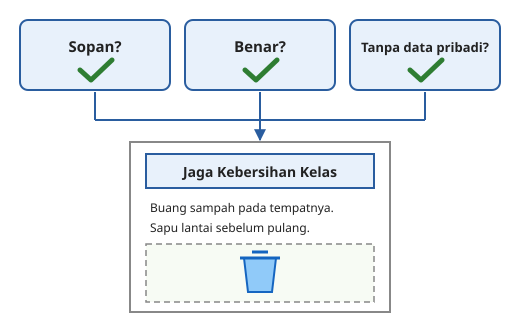

**Ingat dulu:** Tanpa melihat catatan, tulis tiga pertanyaan yang kamu ajukan pada dirimu sebelum membagikan gambar atau tulisan.

**Contoh:** Lembar A, "Jaga Kebersihan Kelas": "Buang sampah pada tempatnya. Sapu lantai sebelum pulang." Sopan? ya. Benar? ya. Tanpa data pribadi? ya.

`[Gambar: tiga kotak berderet, sopan, benar, tanpa data pribadi, masing-masing bertanda centang. Di bawahnya satu lembar kecil berjudul Jaga Kebersihan Kelas.]`

**Bandingkan:** Lembar B memuat tiga kalimat: "Kelas 6 sebelah malas semua." "Sampah plastik hilang sendiri dalam seminggu." "Hubungi Rina di Jalan Contoh No. 1."

| Kalimat | Sopan? | Benar? | Tanpa data pribadi? |
| --- | --- | --- | --- |
| 1 | tidak | ya | ya |
| 2 | ya | ______ | ya |
| 3 | ya | ya | ______ |

Apa yang sama? Apa yang beda? ______

**Coba:** Lembar C: "Teman yang lupa piket itu bodoh." Tulis ulang supaya sopan: ______

Sekarang sendiri: tukar karya minggu lalu dengan temanmu.

| Pertanyaan | ya / belum | Bagian yang diubah |
| --- | --- | --- |
| Sopan? | | |
| Benar? | | |
| Tanpa data pribadi? | | |

Saranku: ______

Perbaiki karyamu, lalu periksa ulang ketiganya.

**Ceritakan** ke temanmu satu perbaikan yang kamu buat dan alasannya.

**Catatan cetak (untuk guru, tidak dicetak):** satu lembar per murid, kertas A4. Lembar tidak memuat kolom nama, kelompok, tanggal, atau nilai; penandaan kertas diurus guru di sekolah.
