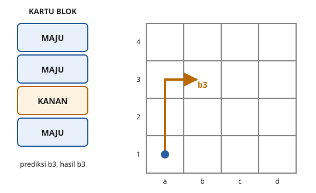

**Ingat dulu:** Tanpa melihat catatan, tulis tiga simbol kesepakatan kelas dan artinya.

**Contoh:** Mesin mulai di a1 menghadap atas. Kartu: MAJU, MAJU, KANAN, MAJU. Prediksi: b3. Hasil: b3.

`[Gambar: di kiri, susunan kartu MAJU, MAJU, KANAN, MAJU dari atas ke bawah. Di kanan, kisi 4x4 dengan jalur dari a1 naik ke a3, belok kanan, dan berakhir di b3.]`

**Bandingkan:**

| | Susunan P | Susunan Q |
| --- | --- | --- |
| Kartu | MAJU 3x, KANAN, MAJU 3x | ULANGI 3 kali [MAJU], KANAN, ULANGI 3 kali [MAJU] |
| Banyak kartu | 7 | 5 |
| Berakhir di | d4 | ______ |

Apa yang sama? Apa yang beda? ______

**Coba:** Susunan R: ULANGI 3 kali [MAJU], KANAN, MAJU. Prediksi: ______ Ganti 3 menjadi 2. Prediksi baru: ______

Sekarang sendiri: susunan S: MAJU, KANAN, ULANGI 3 kali [MAJU], KIRI, MAJU. Boleh di kartu kertas atau di layar sekolah bila guru menyediakan; isinya sama.

| | Prediksi | Hasil |
| --- | --- | --- |
| Susunan S | ______ | ______ |
| Setelah satu kartu kuubah: ______ | ______ | ______ |

Kartu mana yang menentukan tempat berakhir? ______

**Ceritakan** ke temanmu mengapa prediksi ditulis sebelum menjalankan.

**Catatan cetak (untuk guru, tidak dicetak):** satu lembar per murid, kertas A4; kartu blok disiapkan guru. Lembar tidak memuat kolom nama, kelompok, tanggal, atau nilai; penandaan kertas diurus guru di sekolah.
