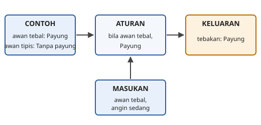

**Ingat dulu:** Tanpa melihat catatan, tulis empat bagian bagan cara kerja KA.

**Contoh:** Bagan payung.

`[Gambar: empat kotak. CONTOH: awan tebal Payung, awan tipis Tanpa payung. ATURAN: bila awan tebal, Payung. MASUKAN: awan tebal, angin sedang. KELUARAN: Payung. Panah dari CONTOH ke ATURAN, dari MASUKAN ke ATURAN, dan dari ATURAN ke KELUARAN.]`

**Bandingkan:**

| | Mesin kotak | Bagan KA |
| --- | --- | --- |
| Aturan | ditulis orang | dicari dari contoh |

Apa yang sama? Apa yang beda? ______

**Coba:** Masukan baru: awan tipis, angin sedang. Keluaran: ______ Sifat yang tidak dipakai aturan: ______

**Sekarang sendiri:** bagan jaket.

| Contoh | Label |
| --- | --- |
| dingin, pagi | Jaket |
| dingin, siang | Jaket |
| hangat, pagi | Tanpa jaket |
| hangat, siang | Tanpa jaket |

ATURAN: bila ______, ______.

| MASUKAN | KELUARAN |
| --- | --- |
| dingin, malam | |
| hangat, malam | |

**Ceritakan** ke temanmu mengapa KA butuh contoh sebelum bisa menebak.

**Catatan cetak (untuk guru, tidak dicetak):** satu lembar per murid, kertas A4. Lembar tidak memuat kolom nama, kelompok, tanggal, atau nilai; penandaan kertas diurus guru di sekolah.
