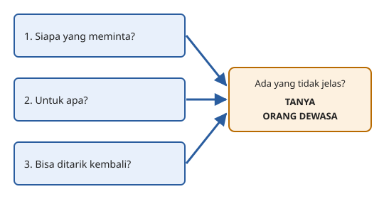

**Ingat dulu:** Tanpa melihat catatan, tulis satu hal yang tidak diberikan kepada layanan KA sembarangan dan alasannya.

**Contoh:** Eko diminta aplikasi tidak dikenal merekam suaranya agar berubah menjadi suara robot.

| Pertanyaan | Jawaban |
| --- | --- |
| Siapa yang meminta? | aplikasi tidak dikenal |
| Untuk apa? | hanya agar lucu |
| Bisa ditarik kembali? | tidak jelas |

Keputusan: TANYA ORANG DEWASA.

`[Gambar: tiga kotak pertanyaan bersusun: siapa yang meminta, untuk apa, bisa ditarik kembali. Panah ke kotak keputusan: bila ada yang tidak jelas, TANYA ORANG DEWASA.]`

**Bandingkan:** Kasus A: Eko dan rekaman suara. Kasus B: guru memperagakan layanan KA di layar kelas dengan gambar kartun buatan guru.

Kasus A: meminta data pribadi, pengelola tidak jelas, keputusan tanya orang dewasa. Kasus B: meminta data pribadi? ______ Pengelola jelas? ______ Keputusan: ______

Apa yang sama? Apa yang beda? ______

**Coba:** Fitri ingin memberikan foto wajah dan tanggal lahir kepada layanan "tebak umur". Data yang diminta: ______ Keputusan: ______

**Sekarang sendiri:**

| Kasus | Siapa, untuk apa, bisa ditarik? | Keputusan dan alasan |
| --- | --- | --- |
| Gita ingin mengirim foto temannya, tanpa bertanya, agar dibuat gambar lucu | | |
| Halaman kuis hewan meminta nama lengkap dan nama sekolah | | |
| Fajar disuruh memasang foto wajahnya supaya boleh main | | |

**Ceritakan** ke temanmu mengapa foto dan suara tidak diberikan kepada layanan sembarangan.

**Catatan cetak (untuk guru, tidak dicetak):** satu lembar per murid, kertas A4. Lembar tidak memuat kolom nama, kelompok, tanggal, atau nilai; penandaan kertas diurus guru di sekolah.
