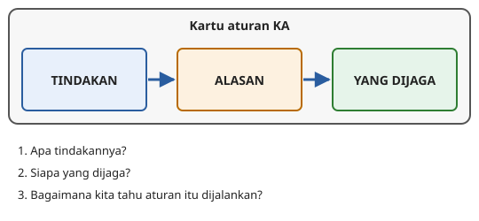

**Ingat dulu:** Tanpa melihat catatan, tulis tiga bagian aturan KA yang baik.

**Contoh:** Aturan: "Kita tidak memberikan foto atau suara orang kepada layanan yang tidak dikenal, karena itu data pribadi yang sulit ditarik kembali, sehingga teman dan keluarga terjaga."

`[Gambar: satu kartu aturan dibagi tiga kotak bersambung panah: TINDAKAN, ALASAN, YANG DIJAGA. Di bawahnya tiga pertanyaan pemeriksa.]`

**Bandingkan:**

| | Aturan X | Aturan Y |
| --- | --- | --- |
| Tulisan | "Gunakan KA dengan baik." | aturan contoh di atas |
| Menyebut tindakan? | tidak | ya |
| Menyebut alasan? | tidak | ______ |
| Menyebut yang dijaga? | tidak | ______ |

Apa yang sama? Apa yang beda? Aturan mana yang bisa diperiksa? ______

**Coba:** Lengkapi: "Kita tidak memakai tebakan mesin untuk ______ teman, karena ______, sehingga ______ terjaga."

**Sekarang sendiri:** tulis satu aturan untuk tiap kasus.

| Kasus | Aturanmu |
| --- | --- |
| Hani menyalin jawaban KA tanpa memahaminya | |
| Indra menyebarkan jawaban KA yang belum diperiksa | |
| Hani memakai KA untuk mengolok-olok temannya | |

Periksa satu aturanmu: apa tindakannya? ______ Siapa yang dijaga? ______ Bagaimana kita tahu aturan itu dijalankan? ______

**Ceritakan** ke temanmu satu aturan dan orang yang dijaganya.

**Catatan cetak (untuk guru, tidak dicetak):** satu lembar per murid, kertas A4. Lembar tidak memuat kolom nama, kelompok, tanggal, atau nilai; penandaan kertas diurus guru di sekolah.
