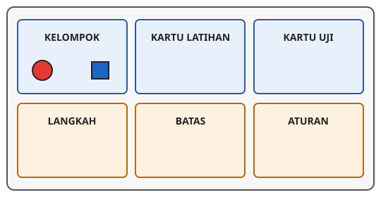

**Ingat dulu:** Tanpa melihat catatan, tulis apa yang kamu periksa agar contoh latihan adil bagi kedua kelompok.

**Contoh:** Rancangan mesin A. Kelompok: Satu (kartu besar), Dua (kartu kecil). Latihan: empat kartu tiap kelompok, beragam. Uji: segitiga merah besar, kotak biru kecil, segitiga merah kecil, bulat hijau sedang. Langkah: ULANGI 4 kali berisi AMBIL satu kartu uji, cocokkan dengan tabel, tulis tebakan, TARUH kartu di kotak tebakan; lalu buka label. Batas: ragu pada sifat baru.

`[Gambar: kertas rancangan dengan enam kotak: KELOMPOK, KARTU LATIHAN, KARTU UJI, LANGKAH, BATAS, ATURAN.]`

**Bandingkan:**

Rancangan A memenuhi lima hal di bawah. Rancangan B: Satu lima kartu bulat, Dua satu kartu kotak biru besar; uji bulat merah besar, kotak merah kecil; sembilan kartu langkah; tanpa batas dan aturan. Tulis ya atau tidak untuk B.

1. Tiap kelompok sama banyak dan beragam: ______
2. Kartu uji beda dari latihan: ______
3. Langkah paling banyak 6 kartu: ______
4. Batas tertulis: ______
5. Aturan: tindakan, alasan, yang dijaga: ______

Apa yang sama? Apa yang beda? ______

**Coba:** Perbaiki B: uji pertama jadi bulat kuning kecil. Tambah Dua: kotak merah besar, kotak kuning kecil, kotak biru kecil. Tebakan bulat kuning kecil ______ kotak merah kecil ______ kotak kuning besar ______

**Sekarang sendiri, bersama kelompokmu:** isi enam kotak rancanganmu di kertas rancangan. Periksa lima hal. Hal yang masih kurang: ______

**Ceritakan** ke temanmu satu hal yang kamu periksa sebelum mulai membuat.

**Catatan cetak (untuk guru, tidak dicetak):** satu lembar per murid, kertas A4; kertas rancangan per kelompok dibuat guru. Lembar tidak memuat kolom nama, kelompok, tanggal, atau nilai; penandaan kertas diurus guru di sekolah.
