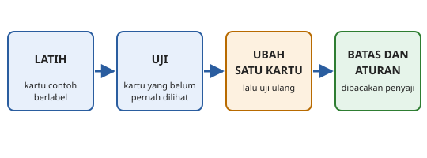

**Ingat dulu:** Tanpa melihat catatan, tulis langkah melatih lalu menguji mesin kartu.

**Contoh:** Mesin K. Latihan Satu: bergaris hijau kecil, polos hijau besar, bertitik hijau besar. Dua: bergaris oranye besar, polos oranye kecil, bertitik oranye kecil. Petunjuk: hijau untuk Satu, oranye untuk Dua. Uji bergaris ungu kecil: ragu, karena ungu belum ada di contoh.

`[Gambar: empat kotak bersambung panah: LATIH, UJI, UBAH SATU KARTU, BATAS DAN ATURAN.]`

**Bandingkan:**

| | Demonstrasi A | Demonstrasi B |
| --- | --- | --- |
| Menyebut kartu yang ragu atau keliru | ya | tidak |
| Menyebut batas mesin | ya | ______ |
| Membacakan aturan | ya | ______ |
| Berkata "selalu benar" | tidak | ya |

Apa yang sama? Apa yang beda? Mana yang bisa diperiksa penonton? ______

**Coba:** Tambah ke mesin K: Dua bergaris ungu besar. Tebakan baru untuk bergaris ungu kecil: ______

**Sekarang sendiri, bersama kelompokmu:** jalankan rancanganmu.

| Kartu uji | Tebakan | Label | Benar, keliru, atau ragu |
| --- | --- | --- | --- |
| 1 | | | |
| 2 | | | |
| 3 | | | |
| 4 | | | |

Kartu latihan yang kamu ubah: ______ Tebakan yang berubah: ______

Batas mesinmu: ______

Aturan penggunaan (tindakan, alasan, yang dijaga): ______

**Ceritakan** ke temanmu satu batas mesinmu dan mengapa mesin tidak boleh dipercaya begitu saja.

**Catatan cetak (untuk guru, tidak dicetak):** satu lembar per murid, kertas A4; kartu dan kotak dibuat kelompok. Lembar tidak memuat kolom nama, kelompok, tanggal, atau nilai; penandaan kertas diurus guru di sekolah.
