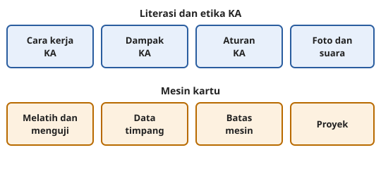

**Ingat dulu:** Tanpa melihat catatan, tulis satu hal dari tiap kelompok: literasi dan etika KA, dan mesin kartu.

**Contoh:** Latihan bentuk soal dengan jawaban lengkap: memilih payung atau kipas.

`[Gambar: dua baris. Baris pertama literasi dan etika KA: cara kerja, dampak, aturan, foto dan suara. Baris kedua mesin kartu: melatih dan menguji, data timpang, batas mesin, proyek.]`

Soal: payung atau kipas? Mana yang dipakai saat hujan? Jawaban: payung, karena melindungi kita dari air hujan.

**Bandingkan:**

- Jawaban A: "payung."
- Jawaban B: "payung, karena melindungi kita dari air hujan."

Apa yang sama? Apa yang beda? Mana yang memuat alasan? ______

**Coba:** Soal: mesin kartu menebak "ragu". Tulis satu alasan mesin ragu: ______

**Sekarang sendiri:** tulis satu aturan KA yang baik: tindakan, alasan, yang dijaga.

______

**Daftar "sudah bisa":** tulis satu contoh yang pernah kamu kerjakan.

| Aku bisa | Contohku |
| --- | --- |
| menulis instruksi logis dengan simbol | |
| menguji dan memperbaikinya | |
| menjelaskan masukan-proses-keluaran | |
| menjaga informasi pribadi | |
| membedakan mesin cerdas dan non-cerdas | |
| menjelaskan KA belajar dari data dan bisa keliru | |

**Refleksi:** Tulis satu hal yang paling berguna dan satu hal yang mau dipelajari lagi.

______

**Ceritakan** ke temanmu satu hal yang kamu pelajari semester ini.

**Catatan cetak (untuk guru, tidak dicetak):** satu lembar per murid, kertas A4. Lembar ini latihan bentuk soal, bukan kuis sumatif; guru menyusun kuis sendiri. Lembar tidak memuat kolom nama, kelompok, tanggal, atau nilai; penandaan kertas diurus guru di sekolah.
