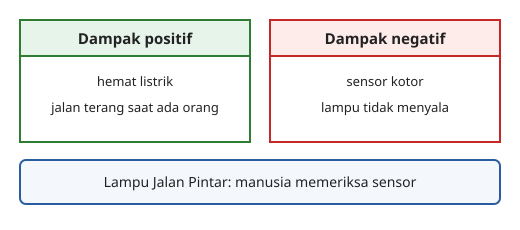

**Ingat dulu:** Tanpa melihat catatan, tulis satu manfaat dan satu dampak KA.

**Contoh:** Lampu Jalan Pintar (kasus fiktif).

`[Gambar: tabel dua kolom, Dampak positif dan Dampak negatif, dengan baris Lampu Jalan Pintar. Positif: hemat listrik, jalan terang saat ada orang. Negatif: sensor kotor, lampu tidak menyala. Di bawahnya tertulis: manusia memeriksa.]`

**Bandingkan:**

| KA | Terbantu | Bisa dirugikan |
| --- | --- | --- |
| Penyaring Pesan | pemilik kotak pesan | pengirim pesan penting |
| Rute Bus Sekolah | penumpang rute ramai | dusun yang sepi penumpang |

Apa yang sama? Apa yang beda? ______

**Coba:** Satu perbaikan agar dusun tidak dirugikan: ______

**Sekarang sendiri:** Penyiram Taman Otomatis (menyiram bila tanah kering).

| Bagian | Isi |
| --- | --- |
| Terbantu | |
| Dampak positif | |
| Dampak negatif | |
| Siapa memeriksa | |
| Satu perbaikan | |

Tukar lembar dengan temanmu. Adakah pihak yang belum disebut? ______

**Ceritakan** ke temanmu mengapa tabel dampak memuat sisi baik dan sisi buruk.

**Catatan cetak (untuk guru, tidak dicetak):** satu lembar per murid, kertas A4. Lembar tidak memuat kolom nama, kelompok, tanggal, atau nilai; penandaan kertas diurus guru di sekolah.
