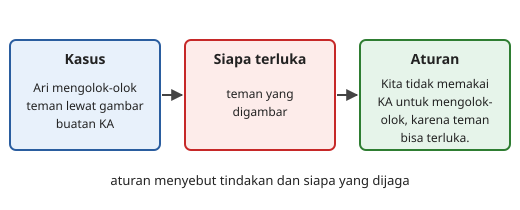

**Ingat dulu:** Tanpa melihat catatan, tulis siapa yang terbantu dan siapa yang bisa dirugikan oleh sebuah KA.

**Contoh:** Kasus Ari (tokoh cerita): Ari meminta KA membuat gambar yang mengolok-olok temannya, lalu ingin mengirimnya ke grup kelas.

`[Gambar: tiga kotak dari kiri ke kanan. Kasus: Ari mengolok-olok teman. Siapa terluka: teman yang digambar. Aturan: Kita tidak memakai KA untuk mengolok-olok teman, karena teman bisa terluka.]`

**Bandingkan:**

| | Kasus Ari | Kasus Bunga |
| --- | --- | --- |
| Perbuatan | mengolok-olok teman | menyalin jawaban KA |
| Yang dirugikan | teman | Bunga sendiri |

Apa yang sama? Apa yang beda? ______

**Coba:** Cahya memberikan foto adiknya kepada aplikasi yang tidak dikenal.

Kita tidak memberikan ______ kepada ______, karena ______.

**Sekarang sendiri:** Ari menyebarkan jawaban KA yang salah ke grup kelas.

Aturanku: Kita ______, karena ______.

Periksa aturanmu:

- Apa tindakannya? ______
- Siapa yang dijaga? ______
- Bagaimana kita tahu aturan dijalankan? ______

**Ceritakan** ke temanmu satu aturan dan siapa yang dijaganya.

**Catatan cetak (untuk guru, tidak dicetak):** satu lembar per murid, kertas A4. Lembar tidak memuat kolom nama, kelompok, tanggal, atau nilai; penandaan kertas diurus guru di sekolah.
