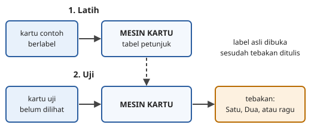

**Ingat dulu:** Tanpa melihat catatan, tulis apa yang dilakukan KA dengan kartu contoh sebelum menebak.

**Contoh:** Mesin A dilatih dua kartu: bulat merah kecil (Satu) dan kotak biru besar (Dua). Kartu uji: bulat kuning besar. Bulat memberi suara Satu, besar memberi suara Dua. Tebakan: ragu.

`[Gambar: panah dari kartu contoh berlabel ke mesin, lalu ke tabel petunjuk. Kartu uji masuk ke mesin dan keluar sebagai tebakan: Satu, Dua, atau ragu. Label asli dibuka sesudah tebakan ditulis.]`

**Bandingkan:** kartu uji yang sama.

| Kartu uji | Mesin A | Mesin B |
| --- | --- | --- |
| bulat kuning besar | ragu | Satu |
| kotak kuning kecil | ragu | Dua |

Apa yang sama? Apa yang beda? Mengapa? ______

**Coba:** Mesin B, kartu uji kotak merah besar. Tebakan: ______

**Sekarang sendiri:** kartu garis.

| Contoh | Label |
| --- | --- |
| bergaris hijau kecil | Satu |
| bergaris oranye besar | Satu |
| bergaris hijau besar | Satu |
| polos hijau kecil | Dua |
| polos oranye kecil | Dua |
| polos oranye besar | Dua |

Petunjuk Satu: ______ Petunjuk Dua: ______

Tebakan sebelum label dibuka: bergaris oranye kecil ______ polos hijau besar ______

Buang bergaris oranye besar dan polos oranye kecil. Tebakan baru: ______ ______

**Ceritakan** ke temanmu mengapa mesin diuji dengan kartu yang belum ia lihat.

**Catatan cetak (untuk guru, tidak dicetak):** satu lembar per murid, kertas A4. Lembar tidak memuat kolom nama, kelompok, tanggal, atau nilai; penandaan kertas diurus guru di sekolah.
