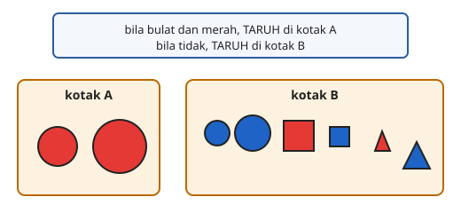

**Ingat dulu:** Tanpa melihat catatan, tulis mengapa kartu uji tidak boleh sama dengan kartu latihan.

**Contoh:** Kotak A: bulat merah kecil, bulat merah besar. Kotak B: bulat biru kecil, bulat biru besar, kotak merah besar, kotak biru kecil, segitiga merah kecil, segitiga biru besar.

`[Gambar: dua kotak berlabel A dan B. Kotak A berisi dua kartu bulat merah, kotak B berisi enam kartu lain. Aturan: bila bulat dan merah, TARUH di kotak A, bila tidak, kotak B.]`

**Bandingkan:** Aturan X: bila bulat, A. Aturan Y: bila bulat dan merah, A. Aturan X salah pada bulat biru kecil dan bulat biru besar.

Apa yang sama? Apa yang beda? ______

**Coba:** A: kotak biru kecil, kotak biru besar. B: kotak merah kecil, bulat biru kecil, bulat merah besar.

Bila ______ dan ______, TARUH di kotak A. Bila tidak, TARUH di kotak B.

**Sekarang sendiri:**

| A | B |
| --- | --- |
| bergaris hijau kecil | bergaris oranye kecil |
| bergaris hijau besar | polos hijau besar |
| | polos oranye kecil |
| | polos oranye besar |

Aturanku: Bila ______ dan ______, TARUH di kotak A. Bila tidak, TARUH di kotak B.

Periksa pada keenam kartu. Ada yang salah tempat? ______

Uji: polos hijau kecil masuk ______. Bergaris oranye besar masuk ______.

**Ceritakan** ke temanmu mengapa aturan diperiksa pada semua contoh.

**Catatan cetak (untuk guru, tidak dicetak):** satu lembar per murid, kertas A4. Lembar tidak memuat kolom nama, kelompok, tanggal, atau nilai; penandaan kertas diurus guru di sekolah.
