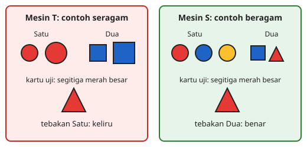

**Ingat dulu:** Tanpa melihat catatan, tulis apa yang terjadi pada tebakan bila contoh latihan hanya sedikit.

**Contoh:** Mesin T: Satu bulat merah kecil, bulat merah besar. Dua kotak biru kecil, kotak biru besar. Kartu uji segitiga merah besar. Merah memberi suara Satu. Tebakan: Satu. Label asli: Dua. Keliru.

`[Gambar: dua kolom. Mesin T: kartu Satu semuanya merah, kartu Dua semuanya biru, tebakan Satu dan keliru. Mesin S: kartu berwarna beragam, tebakan Dua dan benar.]`

**Bandingkan:** kartu uji segitiga merah besar. Mesin T: Satu. Mesin S: Dua.

Apa yang sama? Apa yang beda? Kartu latihan apa yang menyebabkannya? ______

**Coba:** Tambahkan satu kartu ke mesin T: Dua segitiga merah kecil. Tebakan baru untuk segitiga merah besar: ______

**Sekarang sendiri:** mesin T2.

| Contoh | Label |
| --- | --- |
| bergaris hijau kecil | Satu |
| bergaris hijau besar | Satu |
| polos oranye kecil | Dua |
| polos oranye besar | Dua |

| Kartu uji | T2 | Setelah 4 kartu |
| --- | --- | --- |
| bertitik hijau kecil | | |
| polos hijau besar | | |
| bergaris oranye besar | | |

Empat kartu tambahan: Satu bergaris oranye kecil; Dua polos hijau kecil, bertitik hijau besar, bertitik oranye kecil.

Sifat kebetulan apa yang dipakai T2? ______

**Ceritakan** ke temanmu mengapa menambah contoh beragam bisa mengubah tebakan.

**Catatan cetak (untuk guru, tidak dicetak):** satu lembar per murid, kertas A4. Lembar tidak memuat kolom nama, kelompok, tanggal, atau nilai; penandaan kertas diurus guru di sekolah.
