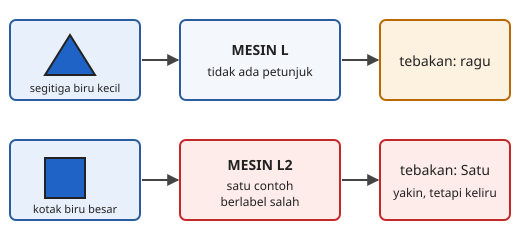

**Ingat dulu:** Tanpa melihat catatan, tulis mengapa contoh yang seragam membuat mesin kartu memakai sifat kebetulan.

**Contoh:** Mesin L: Satu bulat merah kecil, bulat biru besar, bulat kuning kecil. Dua kotak merah besar, kotak biru kecil, kotak kuning besar. Kartu uji segitiga biru kecil: tidak ada petunjuk. Tebakan: ragu.

`[Gambar: dua baris. Atas: segitiga biru kecil masuk mesin L dan keluar sebagai ragu. Bawah: mesin L2 berisi satu kartu berlabel salah menebak Satu dengan yakin, tetapi keliru.]`

**Bandingkan:** mesin L2 sama dengan L, tetapi kotak biru kecil berlabel Satu (salah). Kartu uji kotak biru besar: L menebak Dua, L2 menebak Satu.

Apa yang sama? Apa yang beda? ______

**Coba:** Mesin L2, kartu uji kotak merah kecil. Tebakan: ______ Benar? ______

**Sekarang sendiri:** mesin G.

| Contoh | Label |
| --- | --- |
| bergaris hijau kecil | Satu |
| bergaris oranye besar | Satu |
| bergaris hijau besar | Satu |
| polos oranye besar | Satu |
| polos hijau kecil | Dua |
| polos oranye kecil | Dua |

Tebakan: polos hijau besar ______ bertitik hijau besar ______

Label asli keduanya Dua. Kartu latihan yang aneh: ______

Perbaiki label, uji ulang: ______ ______

Dua hal yang kuperiksa sebelum percaya mesin: ______ ______

**Ceritakan** ke temanmu mengapa tebakan KA tidak boleh dipercaya begitu saja.

**Catatan cetak (untuk guru, tidak dicetak):** satu lembar per murid, kertas A4. Lembar tidak memuat kolom nama, kelompok, tanggal, atau nilai; penandaan kertas diurus guru di sekolah.
