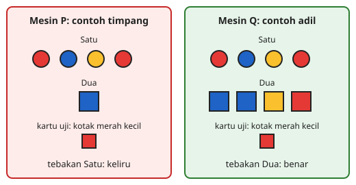

**Ingat dulu:** Tanpa melihat catatan, tulis satu cara membuat contoh latihan lebih adil bagi semua kelompok.

**Contoh:** Mesin P: Satu bulat merah kecil, bulat biru besar, bulat kuning kecil, bulat merah besar. Dua hanya kotak biru besar. Kartu uji kotak merah kecil. Tebakan: Satu. Label asli: Dua. Keliru.

`[Gambar: dua kolom. Mesin P: empat kartu bulat di Satu, satu kartu kotak di Dua, kartu Dua keliru. Mesin Q: empat kartu bulat di Satu, empat kartu kotak di Dua, semua benar.]`

**Bandingkan:** mesin Q sama dengan P, ditambah Dua kotak biru kecil, kotak kuning besar, kotak merah besar. Kartu uji kotak kuning kecil (label Dua). Mesin P: ______ Mesin Q: ______

Apa yang sama? Apa yang beda? Kartu kelompok mana yang keliru pada mesin P? ______

**Coba:** Tambah satu kartu ke mesin P: Dua kotak biru kecil. Tebakan baru untuk kotak merah kecil: ______

**Sekarang sendiri:** mesin R. Satu: bergaris hijau kecil, bergaris hijau besar, bergaris oranye kecil, bergaris oranye besar. Dua: polos hijau besar.

| Kartu uji | Tebakan R | Setelah 3 kartu |
| --- | --- | --- |
| polos hijau kecil | | |
| polos oranye kecil | | |
| bertitik oranye besar | | |

Tiga kartu tambahan, semuanya Dua: polos oranye besar, bertitik hijau besar, bertitik oranye kecil.

Kelompok mana yang contohnya sedikit? ______

**Ceritakan** ke temanmu mengapa contoh yang timpang merugikan satu kelompok.

**Catatan cetak (untuk guru, tidak dicetak):** satu lembar per murid, kertas A4. Lembar tidak memuat kolom nama, kelompok, tanggal, atau nilai; penandaan kertas diurus guru di sekolah.
