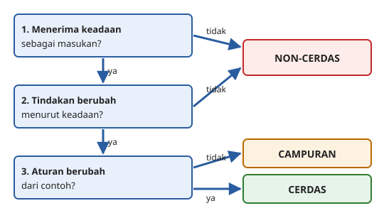

**Ingat dulu:** Tanpa melihat catatan, tulis dua ciri mesin cerdas dan satu mesin non-cerdas.

**Contoh:** Jam weker. 1. Menerima keadaan sebagai masukan? Tidak. 2. Tindakan berubah menurut keadaan? Tidak. 3. Aturan berubah dari contoh? Tidak. Golongan: non-cerdas.

`[Gambar: tiga pertanyaan bersusun. Bila jawaban nomor 1 atau nomor 2 tidak, golongan non-cerdas. Bila nomor 1 dan 2 ya tetapi nomor 3 tidak, campuran. Bila ketiganya ya, cerdas.]`

**Bandingkan:**

| Pertanyaan | Pintu geser toko | Lampu lalu lintas yang belajar dari catatan |
| --- | --- | --- |
| 1. Menerima keadaan? | ya | ya |
| 2. Tindakan berubah? | ya | ya |
| 3. Aturan berubah dari contoh? | tidak | ______ |
| Golongan | campuran | ______ |

Apa yang sama? Apa yang beda? ______

**Coba:** Lampu lalu lintas berwaktu tetap, berubah tiap 30 detik. Jawaban 1, 2, 3: ______ Golongan: ______

**Sekarang sendiri:**

| Kasus | 1 | 2 | 3 | Golongan |
| --- | --- | --- | --- | --- |
| Keran otomatis: air mengalir saat tangan dekat sensor | | | | |
| Penyarankan jumlah masak kantin: mencatat porsi laku tiap hari lalu menyarankan jumlah masak | | | | |
| Gembok sepeda angka | | | | |

Satu kalimat alasan untuk kasus kantin: ______

**Ceritakan** ke temanmu mengapa pintu geser belum bisa disebut cerdas.

**Catatan cetak (untuk guru, tidak dicetak):** satu lembar per murid, kertas A4. Lembar tidak memuat kolom nama, kelompok, tanggal, atau nilai; penandaan kertas diurus guru di sekolah.
