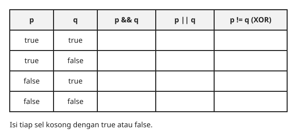

**Ingat dulu:** Tanpa melihat catatan, jawab. (1) Berapa hasil `17 / 5` dan `17 % 5` pada bilangan bulat? ______ (2) Sebutkan dua peran sistem operasi. ______



`[Gambar: tabel kebenaran dengan lima kolom: p, q, p && q, p || q, dan p != q (XOR). Kolom p dan q berisi empat kombinasi true dan false. Tiga kolom hasil kosong dan kamu isi dengan true atau false.]`

**Prediksi:** Tebak dulu, tulis jawabanmu, baru jalankan (`AI: tanpa AI`). `cout` mencetak `bool` sebagai 1 (benar) atau 0 (salah).

```cpp
#include <iostream>
using namespace std;

int main() {
  int n = 14;
  if (n % 2 == 0) {
    cout << "genap\n";
  } else {
    cout << "ganjil\n";
  }
  if (n > 10 && n < 20) {
    cout << "A\n";
  }
  if (n > 10 || n < 0) {
    cout << "B\n";
  }
  if (!(n > 10)) {
    cout << "C\n";
  }
  bool p = true;
  bool q = false;
  cout << (p && q) << (p || q) << (p != q) << "\n";
}
```

Apa saja yang tercetak, dan dalam urutan apa? ______ Mengapa "C" tidak tercetak? ______ Tiga angka pada baris terakhir? ______ Cocokkan angka itu dengan baris `true`/`false` pada gambar.

**Lengkapi:** Program membaca `n`, mencetak `genap` atau `ganjil`, lalu mencetak `kelipatan lima` bila `n` juga kelipatan 5. Isi bagian `____`.

```cpp setengah-jadi
#include <iostream>
using namespace std;

int main() {
  int n;
  cin >> n;
  if (n % ____ == 0) {
    cout << "genap\n";
  } else {
    cout << ____;
  }
  if (n % 5 == ____) {
    cout << "kelipatan lima\n";
  }
}
```

**Susun:** Urutkan baris A sampai K menjadi badan `main` untuk kategori nilai: tolak di luar rentang, A bila 85 ke atas, B bila 70 ke atas, selain itu C. `AI: tanpa AI`.

```text
(A)   } else if (skor >= 70) {
(B)     cout << "A\n";
(C)   cin >> skor;
(D)   int skor;
(E)   if (skor < 0 || skor > 100) {
(F)     cout << "B\n";
(G)   } else if (skor >= 85) {
(H)     cout << "tidak valid\n";
(I)   } else {
(J)     cout << "C\n";
(K)   }
```

Urutan: ______ ______ ______ ______ ______ ______ ______ ______ ______ ______ ______

**Latihan:**

1. `AI: boleh` Isi tabel pada gambar, lalu tulis pseudocode untuk tahun kabisat: habis dibagi 4 tetapi tidak habis dibagi 100, atau habis dibagi 400. Uji dengan 1900, 2000, dan 2024. ______
2. `AI: tanpa AI` Pada `x = 8` dan `y = 0`, apakah kondisi `y != 0 && x / y > 2` mengerjakan pembagian? Mengapa program tetap aman? ______
3. `AI: boleh` Tulis `!(a >= 10 || b < 3)` tanpa tanda `!` di depan kurung. ______
4. `AI: boleh` Janji: "bila hujan maka bawa payung". Tulis kondisi C++ dengan `!hujan || payung` dan sebut hasilnya untuk hujan = 1, payung = 0. ______

**Cek diri:**

- [ ] Saya dapat menulis `if`/`else if`/`else` dengan urutan syarat yang tepat.
- [ ] Saya dapat menyusun tabel kebenaran untuk `&&`, `||`, `!`, dan XOR.
- [ ] Saya dapat menyederhanakan kondisi dengan hukum De Morgan.

**Catatan cetak (untuk guru, tidak dicetak):** dua halaman A4 bila kode dicetak penuh. Kunci ada di modul `a-x1-m10`, bagian "Kunci dan petunjuk". Lembar tidak memuat kolom identitas.
