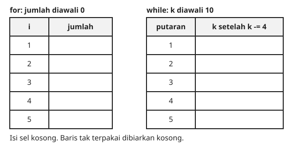

**Ingat dulu:** Tanpa melihat catatan, jawab. (1) Tulis kondisi C++ yang benar bila `n` genap dan lebih dari 10. ______ (2) Ubah bilangan desimal 45 menjadi biner. ______

**Prediksi:** Tebak dulu, tulis jawabanmu pada tabel di gambar, baru jalankan (`AI: tanpa AI`).



`[Gambar: dua tabel. Tabel kiri untuk perulangan for punya kolom i (terisi 1 sampai 5) dan jumlah (kosong). Tabel kanan untuk perulangan while punya kolom putaran (1 sampai 5) dan k setelah k -= 4 (kosong). Kamu mengisi sel yang kosong.]`

```cpp
#include <iostream>
using namespace std;

int main() {
  int jumlah = 0;
  for (int i = 1; i <= 5; i++) {
    jumlah += i;
    cout << i << ": " << jumlah << "\n";
  }
  int k = 10;
  while (k > 0) {
    k -= 4;
    cout << k << " ";
  }
  cout << "\n";
}
```

Berapa kali badan `while` berjalan, dan angka apa saja pada baris terakhir? ______ Mengapa `k` tercetak negatif walaupun syaratnya `k > 0`? ______

**Lengkapi:** Program membaca `k` dan mencetak lima baris pertama tabel perkalian `k`. Isi bagian `____`.

```cpp setengah-jadi
#include <iostream>
using namespace std;

int main() {
  int k;
  cin >> k;
  for (int i = ____; i <= ____; i++) {
    cout << k << " x " << i << " = " << ____ << "\n";
  }
}
```

**Susun:** Urutkan baris A sampai J menjadi badan `main` yang menjumlahkan bilangan **ganjil** dari 1 sampai `n`. `AI: tanpa AI`.

```text
(A)   int jumlah = 0;
(B)     jumlah += i;
(C)   cout << jumlah << "\n";
(D)   int n;
(E)   for (int i = 1; i <= n; i++) {
(F)     if (i % 2 == 0) {
(G)       continue;
(H)     }
(I)   cin >> n;
(J)   }
```

Urutan: ______ ______ ______ ______ ______ ______ ______ ______ ______ ______

**Latihan:**

1. `AI: tanpa AI` Apa yang tercetak oleh `for (int i = 1; i <= 10; i++) { if (i % 3 == 0) { continue; } if (i > 7) { break; } cout << i << " "; }`? ______
2. `AI: boleh` Tulis pseudocode untuk pola segitiga terbalik dengan `n = 4`: empat bintang di baris pertama, tiga di baris kedua, dan seterusnya. ______
3. `AI: boleh` Tulis pseudocode untuk menghitung dan mencetak banyak bilangan prima dari 2 sampai 50 dengan uji prima di dalam perulangan. ______

**Cek diri:**

- [ ] Saya dapat menelusuri `for` dan `while` putaran demi putaran.
- [ ] Saya dapat menjelaskan `break` dan `continue`.
- [ ] Saya dapat menulis uji prima sederhana.

**Catatan cetak (untuk guru, tidak dicetak):** satu sampai dua halaman A4. Kunci ada di modul `a-x1-m11`, bagian "Kunci dan petunjuk". Lembar tidak memuat kolom identitas.
