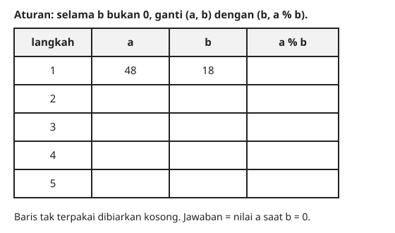

**Ingat dulu:** Tanpa melihat catatan, jawab. (1) Berapa kali badan `for (int i = 0; i < 5; i++)` dijalankan? ______ (2) Mengapa `9 / 5` bukan 1,8 pada C++, dan bagaimana memperbaikinya? ______



`[Gambar: tabel dengan kolom langkah, a, b, dan a % b, lima baris. Baris 1 berisi a = 48 dan b = 18; sel lain kosong. Aturan di atas tabel: selama b bukan 0, ganti (a, b) dengan (b, a % b).]`

**Prediksi:** Tebak dulu, tulis jawabanmu, baru jalankan (`AI: tanpa AI`).

```cpp
#include <iostream>
using namespace std;

int kuadrat(int x) {
  return x * x;
}

void ubah(int a) {
  a = a + 10;
  cout << "dalam: " << a << "\n";
}

int main() {
  int n = 4;
  cout << kuadrat(n) << "\n";
  cout << kuadrat(n + 1) << "\n";
  ubah(n);
  cout << "luar: " << n << "\n";
}
```

Apa yang tercetak pada tiap baris? ______ Fungsi `ubah` menambah 10 pada `a`. Apakah `n` di `main` ikut berubah? Mengapa? ______

**Lengkapi:** Fungsi `maks` mengembalikan yang lebih besar dari dua bilangan; dua pemanggilan bersarang mencari yang terbesar dari tiga. Isi bagian `____`.

```cpp setengah-jadi
#include <iostream>
using namespace std;

____ maks(int p, int q) {
  if (p > q) {
    return ____;
  }
  return ____;
}

int main() {
  int a, b, c;
  cin >> a >> b >> c;
  cout << maks(____, maks(b, c)) << "\n";
}
```

**Susun:** Urutkan baris A sampai H menjadi program yang mencetak keliling persegi panjang 7 kali 3 lewat fungsi. Baris (B) dan (H) sama, jadi boleh bertukar tempat. `AI: tanpa AI`.

```text
(A) int main() {
(B) }
(C)   cout << keliling(7, 3) << "\n";
(D) using namespace std;
(E) int keliling(int p, int l) {
(F)   return 2 * (p + l);
(G) #include <iostream>
(H) }
```

Urutan: ______ ______ ______ ______ ______ ______ ______ ______

**Latihan:**

1. `AI: tanpa AI` Isi tabel pada gambar untuk `fpb(48, 18)`. Berapa hasilnya, dan berapa `fpb(7, 0)`? ______
2. `AI: boleh` Tulis pseudocode untuk fungsi `jumlahDeret(int n)` yang mengembalikan 1 + 2 + ... + n. Uji dengan 100. ______
3. `AI: boleh` Tulis fungsi `void naikkan(int& nilai, int tambah)` yang menambah `nilai` dengan `tambah`. Uji dengan nilai 5 dan tambah 3. ______

**Cek diri:**

- [ ] Saya dapat menjelaskan beda parameter yang disalin dan parameter `&`.
- [ ] Saya dapat menulis faktorial dan FPB dengan fungsi.
- [ ] Saya dapat memecah program menjadi fungsi-fungsi kecil.

**Catatan cetak (untuk guru, tidak dicetak):** satu sampai dua halaman A4. Kunci ada di modul `a-x1-m12`, bagian "Kunci dan petunjuk". Lembar tidak memuat kolom identitas.
