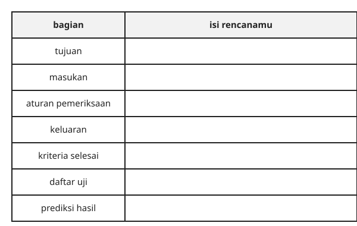

**Ingat dulu:** Tanpa melihat catatan, jawab. (1) Apa beda parameter dan argumen? ______ (2) Apa beda `=` dan `==`? ______



`[Gambar: tabel dua kolom untuk rencana proyek satu halaman. Kolom kiri berisi tujuh bagian: tujuan, masukan, aturan pemeriksaan, keluaran, kriteria selesai, daftar uji, dan prediksi hasil. Kolom kanan kosong; isi dengan rencana proyekmu sendiri.]`

**Prediksi:** Pilih satu proyek data karangan: curah hujan harian dalam milimeter, atau skor ulangan sintetis 0 sampai 100 dengan kode -1 untuk "tidak ikut". Isi tabel pada gambar, lalu tulis deret datamu sendiri (data sintetis, bukan data orang atau tempat nyata) dan prediksi hasilnya: berapa data baik, hilang, di luar rentang, dan lonjakan. ______

**Lengkapi:** Pemeriksa data menandai tiap data menurut aturan tertulis; batas ditulis sebagai konstanta bernama. Isi bagian `____` pada urutan pemeriksaan satu data `x`.

```cpp setengah-jadi
const double HILANG = ____;
const double MIN_SUHU = 15;
const double MAX_SUHU = 40;
const double BATAS_LONJAKAN = ____;

bool dalamRentang(double x) {
  return x >= MIN_SUHU ____ x <= MAX_SUHU;
}

// di dalam perulangan, untuk satu data x:
if (x == HILANG) {
  hilang++;
} else if (____dalamRentang(x)) {
  luar++;
} else if (baik > 0 && fabs(x - terakhirBaik) > ____) {
  lonjakan++;
} else {
  baik++;
}
```

**Latihan:**

1. `AI: boleh` Program membaca `n` lalu `n` data. Apa yang terjadi bila `n = 0`, dan mengapa kasus ini wajib diuji? ______
2. `AI: boleh` Tulis kebalikan dari `x >= 15 && x <= 40` tanpa tanda `!`. ______
3. `AI: tanpa AI` Tulis di kertas kerangka fungsi `char jenis(double x, double terakhirBaik, bool adaBaik)` yang mengembalikan `'H'`, `'R'`, `'L'`, atau `'B'`. ______
4. Mengapa nilai penanda seperti -999 tidak boleh ikut dirata-ratakan? ______

**Cek diri:**

- [ ] Saya dapat menyebut aturan pemeriksaan data saya dan batas-batasnya.
- [ ] Saya menguji nilai biasa, nilai batas, dan `n = 0`.
- [ ] Saya dapat memberi umpan balik dalam tiga bagian: satu yang baik, satu yang perlu diperbaiki, satu langkah berikutnya.

**Catatan cetak (untuk guru, tidak dicetak):** satu sampai dua halaman A4; rencana proyek dinilai dengan rubrik dari guru. Kunci ada di modul `a-x1-m13`, bagian "Kunci dan petunjuk". Lembar tidak memuat kolom identitas.
