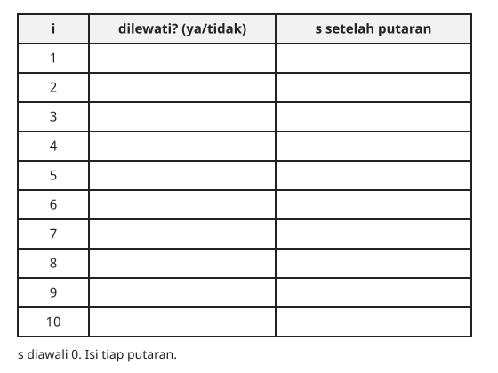

**Ingat dulu:** Ini asesmen formatif, `AI: tanpa AI`. Tanpa melihat catatan, jawab. (1) Mengapa nilai batas perlu diuji, bukan hanya nilai biasa? ______ (2) Apa beda `break` dan `continue`? ______ (3) Ubah bilangan biner `11010` menjadi desimal dan heksadesimal. ______



`[Gambar: tabel dengan tiga kolom: i (terisi 1 sampai 10), "dilewati? (ya/tidak)", dan "s setelah putaran". Dua kolom terakhir kosong. s diawali 0. Kamu mengisinya untuk program pada soal Telusuri.]`

**Latihan:** Kerjakan sendiri, `AI: tanpa AI`, dengan waktu yang ditetapkan gurumu.

1. **Tulis.** Tulis pseudocode lalu program: baca `n`, lalu baca `n` bilangan bulat; cetak jumlah bilangan genap dan banyaknya bilangan ganjil. Pakai fungsi `bool genap(int x)`. ______
2. **Telusuri.** Isi tabel pada gambar untuk `f(1, 10)`. Apa yang tercetak? ______

   ```cpp
   #include <iostream>
   using namespace std;

   int f(int a, int b) {
     int s = 0;
     for (int i = a; i <= b; i++) {
       if (i % 3 == 0) {
         continue;
       }
       s += i;
     }
     return s;
   }

   int main() {
     cout << f(1, 10) << "\n";
   }
   ```

3. **Cari galat.** Potongan berikut maksudnya menghitung rata-rata 1 sampai `n`. Tulis tiga galat, akibatnya, dan perbaikannya.

   ```text
   int jumlah;
   for (int i = 1; i < n; i++) {
     jumlah += i;
   }
   cout << jumlah / n;
   ```

   Galat 1: ______ Galat 2: ______ Galat 3: ______
4. **Praktik.** Kompilasi programmu dari nomor 1 dengan `g++ -std=c++17 -Wall -Wextra`. Tulis dua uji yang kamu pilih, satu di antaranya `n = 0`, beserta hasil yang kamu prediksi. ______
5. **Kuis konsep fondasi.** (a) Dari CPU, RAM, dan SSD, mana yang isinya hilang bila listrik mati? ______ (b) Berapa bit panjang alamat IPv4 seperti `192.0.2.10`, dan mengapa tiap bagiannya paling besar 255? ______ (c) Sebutkan dua kebiasaan untuk mengamankan akun. ______

**Cek diri:**

- [ ] Saya dapat menulis pseudocode dan program dengan percabangan, perulangan, dan fungsi.
- [ ] Saya dapat menelusuri program dengan `for`, `if`, dan `continue`.
- [ ] Saya dapat menemukan galat variabel tak terinisialisasi, selisih satu, dan pembagian bulat.

**Catatan cetak (untuk guru, tidak dicetak):** dua halaman A4. Kunci dan rubrik ada di modul `a-x1-m14`, bagian "Kunci dan petunjuk". Lembar tidak memuat kolom identitas.
