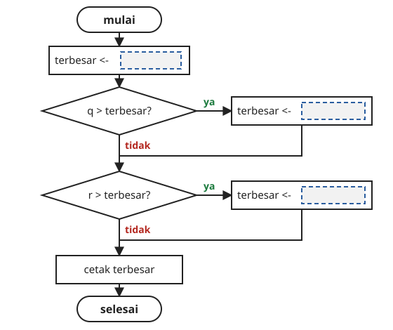

**Ingat dulu:** Tanpa melihat catatan, jawab. (1) Sebutkan tiga bagian siklus Input-Proses-Output dan satu contoh. ______ (2) Ubah bilangan biner `1101` menjadi desimal. ______



`[Gambar: diagram alir dari "mulai" ke "selesai". Kotak pertama mengisi terbesar. Dua belah ketupat bertanya "q > terbesar?" dan "r > terbesar?"; cabang "ya" menuju kotak yang mengisi terbesar, cabang "tidak" langsung ke langkah berikutnya. Setelah itu "cetak terbesar". Tiga kotak berisi "terbesar <-" punya isian kosong yang harus kamu lengkapi.]`

**Prediksi:** Baca program ini dan tebak dulu, tulis jawabanmu, baru jalankan (`AI: tanpa AI`).

```cpp
#include <iostream>

int main() {
  std::cout << "Halo";
  std::cout << " dunia";
  std::cout << "\n";
  std::cout << "Baris dua\n";
}
```

Berapa baris tercetak? ______ Apa isi baris pertama, dan dari mana spasi di antara "Halo" dan "dunia"? ______ Apa yang dilakukan `"\n"`? ______

**Lengkapi:** Jadikan pseudocode "terbesar dari tiga" sebuah program. Isi bagian `____`. Isian yang sama dengan kotak kosong pada gambar.

```cpp setengah-jadi
#include <iostream>

int main() {
  int p = 12;
  int q = 40;
  int r = 25;
  int terbesar = ____;
  if (q > terbesar) {
    terbesar = ____;
  }
  if (r > ____) {
    terbesar = r;
  }
  std::cout << "terbesar = " << terbesar << "\n";
}
```

**Susun:** Urutkan baris A sampai I menjadi program `tukar` (`a` = 7, `b` = 3, lalu nilai keduanya ditukar dan dicetak). `AI: tanpa AI`.

```text
(A)   int sementara = a;
(B) }
(C)   a = b;
(D) int main() {
(E)   int a = 7;
(F)   b = sementara;
(G) #include <iostream>
(H)   int b = 3;
(I)   std::cout << "a = " << a << ", b = " << b << "\n";
```

Urutan: ______ ______ ______ ______ ______ ______ ______ ______ ______

**Latihan:**

1. `AI: tanpa AI` Seseorang menukar dua nilai dengan `a = b;` lalu `b = a;` (tanpa variabel sementara) pada a = 7 dan b = 3. Berapa a dan b setelahnya? Mengapa? ______
2. `AI: boleh` Lengkapi diagram alir pada gambar, lalu telusuri dengan p = 5, q = 5, r = 2.

   | Langkah | terbesar |
   | --- | --- |
   | awal | |
   | setelah q | |
   | setelah r | |

   Hasil: ______ Apakah diagram perlu diubah untuk nilai yang sama besar? ______
3. `AI: boleh` Tulis pseudocode untuk memutar tiga nilai: a diisi nilai b, b diisi nilai c, c diisi nilai a yang lama. ______

**Cek diri:**

- [ ] Saya dapat menyebut tiga langkah dari berkas `.cpp` sampai keluaran.
- [ ] Saya dapat membaca pesan galat `g++` dari yang pertama.
- [ ] Saya dapat menelusuri diagram alir dengan satu nilai.

**Catatan cetak (untuk guru, tidak dicetak):** satu halaman A4. Kunci ada di modul `a-x1-m8`, bagian "Kunci dan petunjuk". Lembar tidak memuat kolom identitas.
