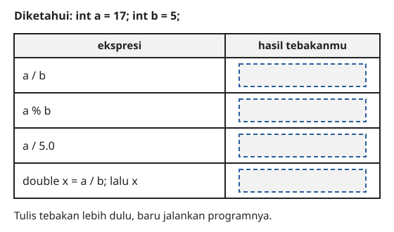

**Ingat dulu:** Tanpa melihat catatan, jawab. (1) Sebutkan tiga langkah dari berkas `.cpp` sampai keluaran tercetak. ______ (2) Apa beda RAM dan penyimpanan? ______

**Prediksi:** Tebak dulu, tulis jawabanmu pada tabel di gambar, baru jalankan (`AI: tanpa AI`).



`[Gambar: tabel dua kolom. Kolom kiri berisi empat ekspresi: a / b, a % b, a / 5.0, dan "double x = a / b; lalu x", dengan int a = 17 dan int b = 5. Kolom kanan berisi kotak kosong untuk hasil tebakanmu.]`

```cpp
#include <iostream>
using namespace std;

int main() {
  int a = 17;
  int b = 5;
  cout << a / b << "\n";
  cout << a % b << "\n";
  cout << a / 5.0 << "\n";
  double x = a / b;
  cout << x << "\n";
}
```

Variabel `x` bertipe `double`. Apakah hasilnya 3,4? Mengapa atau mengapa tidak? ______ Apa fungsi `%`? ______

**Lengkapi:** Konversi suhu Celsius ke Fahrenheit dengan rumus F = C x 9 / 5 + 32. Hati-hati dengan jenis pembagiannya. Isi bagian `____`.

```cpp setengah-jadi
#include <iostream>
#include <iomanip>
using namespace std;

int main() {
  double celsius;
  cin >> ____;
  double fahrenheit = celsius * 9.0 / ____ + 32;
  cout << fixed << setprecision(1) << ____ << "\n";
}
```

**Susun:** Urutkan baris A sampai H menjadi program yang membaca dua bilangan dan mencetak rata-ratanya. `AI: tanpa AI`.

```text
(A)   double rata = (x + y) / 2;
(B) #include <iostream>
(C)   cout << rata << "\n";
(D) }
(E)   cin >> x >> y;
(F) using namespace std;
(G) int main() {
(H)   double x, y;
```

Urutan: ______ ______ ______ ______ ______ ______ ______ ______

**Latihan:**

1. `AI: tanpa AI` Setelah `int a = 7; double b = a / 2; double c = a / 2.0;` berapa nilai b dan c? Jelaskan perbedaannya. ______
2. `AI: boleh` Tulis pseudocode untuk membaca dua bilangan bulat a dan b lalu mencetak hasil bagi bulat dan sisanya. Uji dengan masukan `47 6`. ______
3. `AI: boleh` Baca dua `int`, cetak rata-ratanya sebagai pecahan. Tulis dulu versi yang keliru (hasilnya dibulatkan ke bawah), lalu perbaiki. Uji dengan 7 dan 4. ______

**Cek diri:**

- [ ] Saya dapat memilih tipe yang sesuai untuk suatu nilai.
- [ ] Saya dapat menjelaskan hasil `/` dan `%` pada bilangan bulat.
- [ ] Saya dapat memformat bilangan desimal dengan `fixed` dan `setprecision`.

**Catatan cetak (untuk guru, tidak dicetak):** satu halaman A4. Kunci ada di modul `a-x1-m9`, bagian "Kunci dan petunjuk". Lembar tidak memuat kolom identitas.
