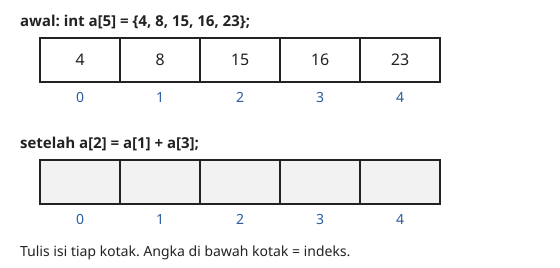

**Ingat dulu:** Tanpa melihat catatan, jawab. (1) Berapa kali badan `for (int i = 0; i < 5; i++)` dijalankan? ______ (2) Kapan sebuah parameter perlu ditulis dengan `&`? ______

**Prediksi:** Tebak dulu, tulis jawabanmu, baru jalankan (`AI: tanpa AI`). Isi kotak kedua pada gambar dengan isi array setelah `a[2] = a[1] + a[3];`.



`[Gambar: dua baris lima kotak berindeks 0 sampai 4. Baris pertama berisi 4, 8, 15, 16, 23. Baris kedua kosong; isi dengan array setelah a[2] = a[1] + a[3].]`

```cpp
#include <iostream>
using namespace std;

int main() {
  int a[5] = {4, 8, 15, 16, 23};
  cout << a[0] << " " << a[4] << "\n";
  a[2] = a[1] + a[3];
  cout << a[2] << "\n";
  int total = 0;
  for (int i = 0; i < 5; i++) {
    total += a[i];
  }
  cout << total << "\n";
}
```

Apa yang tercetak pada tiap baris? ______

**Lengkapi:** Program membaca `n` bilangan dan mencetak berapa banyak yang genap. Isi bagian `____`.

```cpp setengah-jadi
#include <iostream>
using namespace std;

int main() {
  int a[100];
  int n;
  cin >> n;
  for (int i = 0; i < ____; i++) {
    cin >> a[____];
  }
  int genap = ____;
  for (int i = 0; i < n; i++) {
    if (a[i] % 2 == ____) {
      genap++;
    }
  }
  cout << genap << "\n";
}
```

**Susun:** Urutkan baris A sampai I menjadi badan `main` yang membaca `n` bilangan lalu mencetaknya dari yang terakhir ke yang pertama, satu per baris. `AI: tanpa AI`.

```text
(A)   int a[100];
(B)   }
(C)   for (int i = n - 1; i >= 0; i--) {
(D)   int n;
(E)   cin >> n;
(F)   for (int i = 0; i < n; i++) {
(G)     cin >> a[i];
(H)   }
(I)     cout << a[i] << "\n";
```

Urutan: ______ ______ ______ ______ ______ ______ ______ ______ ______

**Latihan:**

1. `AI: tanpa AI` Buat tabel penelusuran `balik` untuk array 2, 7, 1, 8 (`n = 4`): tulis isi array setelah tiap pertukaran. Apa hasil akhirnya? ______
2. `AI: boleh` Tulis pseudocode yang membaca `n` suhu sintetis (bilangan bulat) dan mencetak selisih antara suhu tertinggi dan terendah. Uji dengan 28 31 25 30 27 29. ______
3. `AI: boleh` Cetak indeks (mulai dari 0) kemunculan pertama nilai terbesar. Uji dengan 6 / 4 9 2 9 1 7. ______

**Cek diri:**

- [ ] Saya dapat menjelaskan bahwa indeks array dimulai dari 0.
- [ ] Saya dapat mencari maksimum, minimum, dan rata-rata.
- [ ] Saya dapat membalik array dengan pertukaran sampai tengah.

**Catatan cetak (untuk guru, tidak dicetak):** satu sampai dua halaman A4. Kunci ada di modul `a-x2-m1`, bagian "Kunci dan petunjuk". Lembar tidak memuat kolom identitas.
