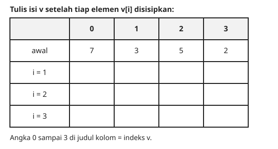

**Ingat dulu:** Tanpa melihat catatan, jawab. (1) Setelah satu putaran penuh bubble sort menaik, elemen mana yang pasti sudah di tempat akhirnya? ______ (2) Mengapa memanggil `top()` atau `front()` pada wadah kosong berbahaya, dan bagaimana mencegahnya? ______ (3) Bagaimana membandingkan dua `string` menurut urutan abjad? ______



`[Gambar: tabel dengan kolom indeks 0 sampai 3. Baris "awal" berisi 7, 3, 5, 2. Tiga baris di bawahnya, "i = 1", "i = 2", dan "i = 3", kosong untuk kamu isi dengan isi v setelah tiap elemen disisipkan.]`

**Prediksi:** Tebak dulu, tulis jawabanmu pada tabel di gambar, baru jalankan (`AI: tanpa AI`).

```cpp
#include <iostream>
#include <vector>
using namespace std;

int main() {
  vector<int> v = {7, 3, 5, 2};
  int n = v.size();
  for (int i = 1; i < n; i++) {
    int x = v[i];
    int j = i - 1;
    while (j >= 0 && v[j] > x) {
      v[j + 1] = v[j];
      j--;
    }
    v[j + 1] = x;
    cout << "i = " << i << ":";
    for (int k = 0; k < n; k++) {
      cout << " " << v[k];
    }
    cout << "\n";
  }
}
```

Setelah baris `i = 2`, bagian mana dari `v` yang pasti terurut? ______

**Lengkapi:** Insertion sort. Isi bagian `____`.

```cpp setengah-jadi
int n = v.size();
for (int i = ____; i < n; i++) {
  int x = v[i];
  int j = i - 1;
  while (j >= 0 && v[j] ____ x) {
    v[j + 1] = ____;
    j--;
  }
  v[____] = x;
}
```

**Susun:** Urutkan baris A sampai G (indentasi ikut barisnya) menjadi badan satu putaran `for` insertion sort. `AI: tanpa AI`.

```text
(A)     int x = v[i];
(B)     v[j + 1] = x;
(C)       j--;
(D)     while (j >= 0 && v[j] > x) {
(E)       v[j + 1] = v[j];
(F)     int j = i - 1;
(G)     }
```

Urutan: ______ ______ ______ ______ ______ ______ ______

**Latihan:**

1. `AI: tanpa AI` Untuk data `5 2 4 1`, tulis isi data setelah tiap elemen disisipkan dan jumlah geseran seluruhnya.

   | langkah | isi data | geseran |
   | --- | --- | --- |
   | awal | 5 2 4 1 | |
   | i = 1 | | |
   | i = 2 | | |
   | i = 3 | | |

2. `AI: boleh` Tulis pseudocode yang mengurutkan `n` bilangan **menurun** dengan insertion sort dan mencetak hasil serta banyak geseran. Uji dengan `5` dan `3 8 1 9 2`. ______
3. `AI: boleh` Perkirakan dulu banyak perbandingan insertion sort dan bubble sort (dengan penghenti dini) pada data `1 2 4 3 5 6`. ______
4. `AI: boleh` Baca `n`, lalu `n` pasang (kode, skor); urutkan **menurun menurut skor**, memindahkan kode bersama skornya. Uji dengan `4` dan `A1 70 B2 85 C3 60 D4 85`. Apa yang terjadi pada B2 dan D4 yang sama-sama 85? ______

**Cek diri:**

- [ ] Saya dapat menelusuri insertion sort langkah demi langkah.
- [ ] Saya dapat membandingkan jumlah perbandingan dua pengurut.
- [ ] Saya dapat menyebut pada data apa insertion sort sangat cepat.

**Catatan cetak (untuk guru, tidak dicetak):** dua halaman A4. Kunci ada di modul `a-x2-m10`, bagian "Kunci dan petunjuk". Lembar tidak memuat kolom identitas.
