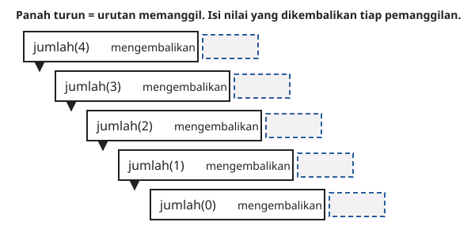

**Ingat dulu:** Tanpa melihat catatan, jawab. (1) Pada insertion sort, apa yang pasti benar tentang bagian kiri `v` setelah elemen ke-`i` disisipkan? ______ (2) Apa yang dilakukan `return`, dan apa yang terjadi pada variabel yang dibuat di dalam fungsi setelah fungsi selesai? ______



`[Gambar: lima kotak bertingkat dari kiri atas ke kanan bawah, berjudul jumlah(4), jumlah(3), jumlah(2), jumlah(1), dan jumlah(0). Panah turun menunjukkan urutan pemanggilan. Setiap kotak berisi kata "mengembalikan" diikuti kotak kosong untuk nilai yang dikembalikan.]`

**Prediksi:** Tebak dulu, tulis jawabanmu, baru jalankan (`AI: tanpa AI`).

```cpp
#include <iostream>
using namespace std;

int fak(int n) {
  cout << "masuk fak(" << n << ")\n";
  if (n <= 1) {
    cout << "keluar fak(" << n << ") = 1\n";
    return 1;
  }
  int hasil = n * fak(n - 1);
  cout << "keluar fak(" << n << ") = " << hasil << "\n";
  return hasil;
}

int main() {
  fak(3);
}
```

Tuliskan keenam baris keluarannya berurutan. ______ Mana yang selesai lebih dulu: `fak(3)` atau `fak(1)`? Mengapa? ______

**Lengkapi:** Fungsi berikut menjumlahkan `1 + 2 + ... + n`. Isi bagian `____`.

```cpp setengah-jadi
int jumlah(int n) {
  if (n == ____) {
    return 0;
  }
  return ____ + jumlah(____);
}
```

**Susun:** Urutkan baris A sampai F menjadi fungsi rekursif yang menghitung 2 pangkat `n`. `AI: tanpa AI`.

```text
(A) int pangkatDua(int n) {
(B)   return 2 * pangkatDua(n - 1);
(C)     return 1;
(D) }
(E)   if (n == 0) {
(F)   }
```

Urutan: ______ ______ ______ ______ ______ ______

**Latihan:**

1. `AI: tanpa AI` Untuk `jumlah(4)` dari bagian Lengkapi, isi kotak pada gambar: tulis nilai yang dikembalikan tiap pemanggilan, dari yang paling dalam ke luar. ______
2. `AI: boleh` Tulis pseudocode fungsi rekursif `long long pangkat(long long a, int n)` yang menghitung `a` pangkat `n`. Uji dengan `2 10`. ______
3. `AI: boleh` Tulis `int jumlahDigit(int n)` secara rekursif: jumlah digit `n` adalah digit terakhirnya ditambah jumlah digit sisanya. Uji dengan 4096. ______

**Cek diri:**

- [ ] Saya dapat menyebut kasus dasar dan langkah rekursif pada sebuah fungsi.
- [ ] Saya dapat menelusuri pemanggilan rekursif dengan tumpukan pemanggilan.
- [ ] Saya dapat menjelaskan mengapa Fibonacci rekursif sederhana lambat.

**Catatan cetak (untuk guru, tidak dicetak):** dua halaman A4. Kunci ada di modul `a-x2-m11`, bagian "Kunci dan petunjuk". Lembar tidak memuat kolom identitas.
