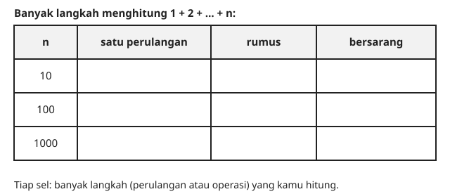

**Ingat dulu:** Tanpa melihat catatan, jawab. (1) Apa dua bagian yang wajib ada pada fungsi rekursif? ______ (2) Bagaimana memeriksa bahwa `n` habis dibagi `d`? ______



`[Gambar: tabel dengan kolom n, satu perulangan, rumus, dan bersarang. Tiga baris n = 10, 100, dan 1000. Semua sel hasil kosong untuk banyak langkah yang kamu hitung.]`

**Prediksi:** Tebak dulu, tulis jawabanmu, baru jalankan (`AI: tanpa AI`).

```cpp
#include <iostream>
using namespace std;

void hitung(int n, int& satu, int& dua) {
  satu = 0;
  dua = 0;
  for (int i = 1; i <= n; i++) {
    satu++;
  }
  for (int i = 1; i <= n; i++) {
    for (int j = 1; j <= i; j++) {
      dua++;
    }
  }
}

int main() {
  int satu, dua;
  hitung(10, satu, dua);
  cout << "n = 10: " << satu << " " << dua << "\n";
  hitung(20, satu, dua);
  cout << "n = 20: " << satu << " " << dua << "\n";
}
```

Apa yang tercetak pada tiap baris? ______ Ketika `n` menjadi dua kali lebih besar, angka pertama menjadi berapa kali, dan angka kedua kira-kira berapa kali? ______

**Lengkapi:** Program berikut menghitung banyak perbandingan cara pasangan untuk `n = 5`. Isi bagian `____`.

```cpp setengah-jadi
int n = 5;
int langkah = 0;
for (int i = 0; i < n; i++) {
  for (int j = ____; j < n; j++) {
    langkah++;
  }
}
cout << langkah << " " << n * (n - ____) / 2 << "\n";
```

**Susun:** Urutkan baris A sampai G (indentasi ikut barisnya) menjadi badan fungsi yang mengembalikan banyak langkah perulangan bersarang `n` kali `n`. `AI: tanpa AI`.

```text
(A)   long long langkah = 0;
(B)   for (int i = 1; i <= n; i++) {
(C)     for (int j = 1; j <= n; j++) {
(D)       langkah++;
(E)     }
(F)   }
(G)   return langkah;
```

Urutan: ______ ______ ______ ______ ______ ______ ______

**Latihan:**

1. `AI: boleh` Isi tabel pada gambar untuk tiga cara menghitung `1 + 2 + ... + n`: satu perulangan, rumus `n * (n + 1) / 2`, dan perulangan bersarang yang menambah 1 sebanyak `i` kali untuk tiap `i`. ______
2. `AI: tanpa AI` Untuk tiap potongan, nyatakan apakah langkahnya tetap, naik secara log, linear, atau kuadrat, dan beri satu alasan.

   ```text
   (a) x = a[0]; y = a[n - 1];
   (b) untuk i dari 0 sampai n - 1: cetak a[i]
   (c) untuk i dari 0 sampai n - 1: untuk j dari 0 sampai n - 1: bandingkan a[i] dan a[j]
   (d) selama n > 1: n = n / 2
   ```

   (a) ______ (b) ______ (c) ______ (d) ______
3. `AI: boleh` Tulis program yang mencetak, untuk `n` sama dengan 1, 2, 4, 8, sampai 1024, berapa kali `n` dapat dibagi dua sampai menjadi 1. Apa kaitan angkanya dengan pencarian biner? ______

**Cek diri:**

- [ ] Saya dapat menghitung banyak langkah perulangan tunggal dan bersarang.
- [ ] Saya dapat membandingkan dua solusi dengan tabel banyak langkah.
- [ ] Saya dapat memperkirakan apakah sebuah solusi masuk akal untuk `n` besar.

**Catatan cetak (untuk guru, tidak dicetak):** dua halaman A4. Kunci ada di modul `a-x2-m12`, bagian "Kunci dan petunjuk". Lembar tidak memuat kolom identitas.
