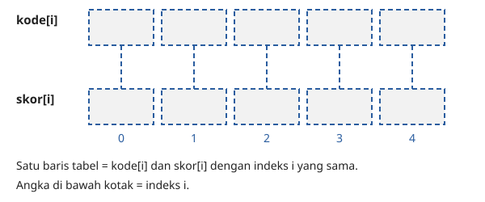

**Ingat dulu:** Tanpa melihat catatan, jawab. (1) Mengapa membandingkan algoritma dengan menghitung banyak langkah, bukan lama waktu dalam detik? ______ (2) Mengapa KPK sebaiknya dihitung `a / fpb(a, b) * b`, bukan `a * b / fpb(a, b)`? ______



`[Gambar: dua baris lima kotak kosong berindeks 0 sampai 4. Baris atas diberi nama kode[i], baris bawah skor[i]. Garis putus-putus menghubungkan kotak berindeks sama: satu baris tabel adalah kode[i] dan skor[i] dengan i yang sama.]`

**Prediksi:** Rencanakan proyek tabel sintetis (misalnya kode dan skor kuis karangan). Isi dua baris kotak pada gambar dengan lima baris data karanganmu, lalu tulis rencana tujuh bagian di bawah, termasuk prediksi hasil untuk datamu.

| Bagian | Isi rencanamu |
| --- | --- |
| Tujuan | |
| Masukan | |
| Aturan | |
| Keluaran | |
| Kriteria selesai | |
| Daftar uji | |
| Prediksi hasil | |

**Lengkapi:** Mengurutkan dua vector paralel menurut kode dengan insertion sort: kedua kolom harus ikut berpindah. Isi bagian `____`.

```cpp setengah-jadi
void urut(vector<string>& kode, vector<int>& skor) {
  int n = kode.size();
  for (int i = 1; i < n; i++) {
    string k = kode[i];
    int s = skor[i];
    int j = i - 1;
    while (j >= 0 && kode[j] ____ k) {
      kode[j + 1] = kode[j];
      skor[j + 1] = ____;
      j--;
    }
    kode[j + 1] = ____;
    skor[j + 1] = ____;
  }
}
```

**Latihan:**

1. `AI: boleh` Tulis pseudocode untuk membaca `n` pasang (kode, skor) ke dua `vector`, lalu melaporkan "Tabel kosong." bila `n = 0`. ______
2. `AI: boleh` Sebut daftar uji minimal untuk proyek tabelmu: data biasa, `n = 0`, `n = 1`, kode yang tidak ada, kode pertama dan terakhir, dan dua skor sama. Tulis hasil yang kamu prediksi untuk dua di antaranya. ______
3. `AI: tanpa AI` Mengapa data harus terurut menurut kolom pencarian sebelum pencarian biner? ______

**Cek diri:**

- [ ] Saya dapat menyebut aturan urut, cari, dan rekap pada proyek saya.
- [ ] Saya memindahkan kedua kolom bersama saat mengurutkan.
- [ ] Saya menguji nilai biasa, nilai batas, `n = 0`, dan kode yang tidak ada.

**Catatan cetak (untuk guru, tidak dicetak):** dua halaman A4; proyek dinilai dengan rubrik dari guru. Kunci ada di modul `a-x2-m13`, bagian "Kunci dan petunjuk". Lembar tidak memuat kolom identitas.
