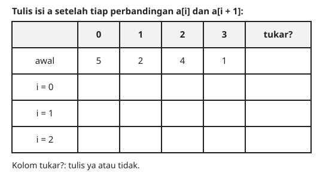

**Ingat dulu:** Ini asesmen formatif, `AI: tanpa AI`. Tanpa melihat catatan, jawab. (1) Mengapa kedua kolom sebuah tabel harus dipindahkan bersama saat diurutkan? ______ (2) Mengapa rekursi tanpa kasus dasar berbahaya, dan apa hubungannya dengan tumpukan pemanggilan? ______ (3) Apa syarat data agar pencarian biner boleh dipakai, dan mengapa syarat itu perlu? ______



`[Gambar: tabel dengan kolom indeks 0 sampai 3 dan "tukar?". Baris "awal" berisi 5, 2, 4, 1. Tiga baris "i = 0", "i = 1", dan "i = 2" kosong untuk isi a setelah tiap perbandingan a[i] dan a[i + 1].]`

**Latihan:** Kerjakan sendiri, `AI: tanpa AI`, dengan waktu yang ditetapkan gurumu.

1. **Tulis (tumpukan).** Sebuah editor karangan membaca satu kata tanpa spasi berisi huruf dan tanda `#`. Huruf menambah teks; `#` membatalkan huruf terakhir, dan tidak berbuat apa-apa bila teks masih kosong. Tulis pseudocode lalu program dengan `stack<char>` yang mencetak teks akhir. Uji dengan `ab#c`, `##x#`, dan `kode#aa##`. ______
2. **Telusuri.** Isi tabel pada gambar untuk program ini, lalu tulis apa yang tercetak. Elemen mana yang pasti sudah di tempat akhirnya? ______

   ```cpp
   #include <iostream>
   #include <vector>
   using namespace std;

   int main() {
     vector<int> a = {5, 2, 4, 1};
     int tukar = 0;
     for (int i = 0; i + 1 < (int)a.size(); i++) {
       if (a[i] > a[i + 1]) {
         int t = a[i];
         a[i] = a[i + 1];
         a[i + 1] = t;
         tukar++;
       }
     }
     for (int x : a) {
       cout << x << " ";
     }
     cout << "\n" << tukar << "\n";
   }
   ```

3. **Cari galat.** Potongan pencarian biner berikut sengaja salah. Tulis tiga galat, akibat masing-masing, dan perbaikannya.

   ```text
   int cari(const vector<int>& a, int x) {
     int kiri = 0;
     int kanan = a.size();
     while (kiri <= kanan) {
       int tengah = (kiri + kanan) / 2;
       if (a[tengah] = x) {
         return tengah;
       } else if (a[tengah] < x) {
         kiri = tengah;
       } else {
         kanan = tengah - 1;
       }
     }
     return -1;
   }
   ```

   Galat 1: ______ Galat 2: ______ Galat 3: ______
4. **Pilih dan jelaskan.** Pilih `vector`, `stack`, atau `queue`, dan beri satu alasan: (a) berkas yang menunggu dicetak, dicetak sesuai urutan datang; (b) halaman yang dikunjungi, untuk tombol "kembali"; (c) nilai 30 murid karangan yang akan diurutkan dan dicari. ______
5. **Rekursi.** Tulis fungsi rekursif `int jumlahDigit(int n)` yang menjumlahkan digit bilangan bulat tak negatif. Sebutkan kasus dasar dan langkah rekursifnya, lalu telusuri `jumlahDigit(4096)`. ______

**Cek diri:**

- [ ] Saya dapat memakai `vector`, `stack`, dan `queue` dan memeriksa `empty()` lebih dulu.
- [ ] Saya dapat menelusuri satu putaran bubble sort dan menjelaskan insertion sort.
- [ ] Saya dapat menemukan galat batas indeks, `=` yang tertukar dengan `==`, dan batas yang tidak bergeser.

**Catatan cetak (untuk guru, tidak dicetak):** dua halaman A4. Kunci dan rubrik ada di modul `a-x2-m14`, bagian "Kunci dan petunjuk". Lembar tidak memuat kolom identitas.
