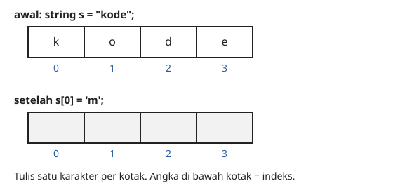

**Ingat dulu:** Tanpa melihat catatan, jawab. (1) Apa indeks elemen pertama dan terakhir array berukuran `n`? ______ (2) Apa beda pseudocode dan program C++? ______

**Prediksi:** Tebak dulu, tulis jawabanmu, baru jalankan (`AI: tanpa AI`). Isi baris kotak kedua pada gambar dengan isi `s` setelah `s[0] = 'm';`.



`[Gambar: dua baris empat kotak berindeks 0 sampai 3. Baris pertama berisi k, o, d, e. Baris kedua kosong; isi dengan string setelah s[0] = 'm'.]`

```cpp
#include <iostream>
#include <string>
using namespace std;

int main() {
  string s = "kode";
  cout << s.size() << " " << s[0] << s[3] << "\n";
  s[0] = 'm';
  cout << s << "\n";
  string t = s + "!";
  cout << t << " " << (s < "mata") << "\n";
}
```

Apa yang tercetak pada tiap baris? ______ Pada baris terakhir, mengapa perbandingan `s < "mata"` bernilai 0 atau 1? ______

**Lengkapi:** Program membaca satu baris dan mencetak berapa kali huruf `a` muncul. Isi bagian `____`.

```cpp setengah-jadi
#include <iostream>
#include <string>
using namespace std;

int main() {
  string s;
  ____(cin, s);
  int n = s.____();
  int banyak = 0;
  for (int i = 0; i < ____; i++) {
    if (s[i] == ____) {
      banyak++;
    }
  }
  cout << banyak << "\n";
}
```

**Susun:** Urutkan baris A sampai J (indentasi ikut barisnya) menjadi badan `main` yang membaca satu kata dan mencetaknya dengan tanda hubung di antara karakternya, misalnya `k-o-d-e`. `AI: tanpa AI`.

```text
(A)     cout << "-";
(B)   cout << "\n";
(C)   }
(D)   string s;
(E)   int n = s.size();
(F)     cout << s[i];
(G)   for (int i = 0; i < n; i++) {
(H)     }
(I)   cin >> s;
(J)     if (i > 0) {
```

Urutan: ______ ______ ______ ______ ______ ______ ______ ______ ______ ______

**Latihan:**

1. `AI: tanpa AI` Buat tabel penelusuran `palindrom("kakek")`: nilai `i`, dua karakter yang dibandingkan, dan hasilnya. Apa nilai yang dikembalikan, dan pada `i` berapa?

   ```cpp
   #include <string>
   using namespace std;

   bool palindrom(string s) {
     int n = s.size();
     for (int i = 0; i < n / 2; i++) {
       if (s[i] != s[n - 1 - i]) {
         return false;
       }
     }
     return true;
   }
   ```

   | `i` | karakter kiri | karakter kanan | sama? |
   | --- | --- | --- | --- |
   | | | | |
   | | | | |
   | | | | |

2. `AI: boleh` Baca satu kata dan cetak kata itu dari belakang (`kode` menjadi `edok`). Tulis pseudocodenya. ______
3. `AI: boleh` Baca satu kata campuran huruf dan angka, lalu cetak jumlah angkanya saja. Uji dengan `a1b2c3`; gunakan syarat `c >= '0' && c <= '9'`. ______

**Cek diri:**

- [ ] Saya dapat membaca satu kata dengan `cin` dan satu baris dengan `getline`.
- [ ] Saya dapat mengakses dan mengubah karakter lewat indeks.
- [ ] Saya dapat membedakan `'a'` dan `"a"`.

**Catatan cetak (untuk guru, tidak dicetak):** satu sampai dua halaman A4. Kunci ada di modul `a-x2-m2`, bagian "Kunci dan petunjuk". Lembar tidak memuat kolom identitas.
