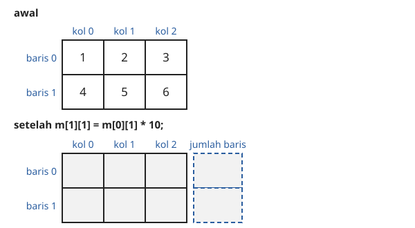

**Ingat dulu:** Tanpa melihat catatan, jawab. (1) Apa beda `cin >> s` dan `getline(cin, s)`? ______ (2) Pada `for (int i = 0; i < 3; i++)` dengan `for (int j = 0; j < 4; j++)` di dalamnya, berapa kali badan yang paling dalam dijalankan? ______

**Prediksi:** Tebak dulu, tulis jawabanmu, baru jalankan (`AI: tanpa AI`). Isi tabel kedua pada gambar, termasuk kotak jumlah tiap baris.



`[Gambar: dua tabel dua baris tiga kolom, dengan penanda baris 0 sampai 1 dan kolom 0 sampai 2. Tabel atas berisi 1 2 3 dan 4 5 6. Tabel bawah kosong, ditambah dua kotak "jumlah baris" di sisi kanan; isi setelah m[1][1] = m[0][1] * 10.]`

```cpp
#include <iostream>
using namespace std;

int main() {
  int m[2][3] = {{1, 2, 3}, {4, 5, 6}};
  cout << m[0][2] << " " << m[1][0] << "\n";
  m[1][1] = m[0][1] * 10;
  for (int i = 0; i < 2; i++) {
    int baris = 0;
    for (int j = 0; j < 3; j++) {
      baris += m[i][j];
    }
    cout << baris << "\n";
  }
}
```

Apa yang tercetak pada tiap baris? ______

**Lengkapi:** Program membaca matriks persegi `n` kali `n` dan mencetak jumlah diagonal utamanya (elemen yang barisnya sama dengan kolomnya). Isi bagian `____`.

```cpp setengah-jadi
#include <iostream>
using namespace std;

int main() {
  int m[50][50];
  int n;
  cin >> n;
  for (int i = 0; i < ____; i++) {
    for (int j = 0; j < n; j++) {
      cin >> ____;
    }
  }
  int jumlah = ____;
  for (int i = 0; i < n; i++) {
    jumlah += m[i][____];
  }
  cout << jumlah << "\n";
}
```

**Susun:** Urutkan baris A sampai H (indentasi ikut barisnya) menjadi badan `main` yang mencetak jumlah seluruh elemen tabel 2 kali 3. `AI: tanpa AI`.

```text
(A)   int total = 0;
(B)   }
(C)       total += m[i][j];
(D)   cout << total << "\n";
(E)     }
(F)   int m[2][3] = {{1, 2, 3}, {4, 5, 6}};
(G)   for (int i = 0; i < 2; i++) {
(H)     for (int j = 0; j < 3; j++) {
```

Urutan: ______ ______ ______ ______ ______ ______ ______ ______

**Latihan:**

1. `AI: tanpa AI` Tulis hasil transpos tabel 2 kali 3 berisi baris 7 8 9 dan 1 2 3. Berapa baris dan kolom hasilnya? ______
2. `AI: boleh` Untuk matriks persegi, tulis rumus jumlah diagonal sekunder (`m[i][n - 1 - i]`) dan hitung untuk matriks 3 kali 3: 2 0 1, lalu 0 3 0, lalu 4 0 5. ______
3. `AI: boleh` Tabel berisi 0 dan 1 menandai petak kosong (0) dan terisi (1) pada denah karangan. Tulis pseudocode untuk mencetak banyak petak kosong. Uji dengan tabel 3 kali 4: 1 0 0 1, lalu 0 0 1 1, lalu 1 1 0 0. ______

**Cek diri:**

- [ ] Saya dapat menyebut indeks pertama sebagai baris dan indeks kedua sebagai kolom.
- [ ] Saya dapat menghitung jumlah baris, kolom, dan diagonal.
- [ ] Saya dapat membuat transpos tabel ke array baru.

**Catatan cetak (untuk guru, tidak dicetak):** dua halaman A4. Kunci ada di modul `a-x2-m3`, bagian "Kunci dan petunjuk". Lembar tidak memuat kolom identitas.
