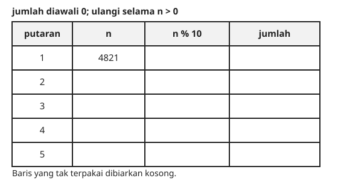

**Ingat dulu:** Tanpa melihat catatan, jawab. (1) Pada `m[b][k]`, mana indeks baris dan mana indeks kolom? ______ (2) Mengapa mengakses `a[n]` pada array berukuran `n` adalah kesalahan? ______ (3) Tulis `!(p && q)` dalam bentuk lain dengan hukum De Morgan. ______



`[Gambar: tabel dengan kolom putaran, n, n % 10, dan jumlah, lima baris. Baris 1 berisi n = 4821; sel lain kosong. Di atas tabel: jumlah diawali 0, ulangi selama n > 0.]`

**Prediksi:** Tebak dulu, tulis jawabanmu, baru jalankan (`AI: tanpa AI`).

```cpp
#include <iostream>
using namespace std;

int main() {
  int n = 4821;
  cout << n % 2 << " " << n % 10 << " " << n / 10 << "\n";
  cout << (n % 3 == 0) << " " << (n % 7 == 0) << "\n";
}
```

Apa yang tercetak pada tiap baris? ______ Mengapa `n % 10` memberi digit terakhir, dan apa yang diberikan `n / 10`? ______

**Lengkapi:** Program membaca `n` positif dan mencetak banyak digitnya. Isi bagian `____`.

```cpp setengah-jadi
#include <iostream>
using namespace std;

int main() {
  int n;
  cin >> n;
  int banyak = 0;
  while (n ____ 0) {
    banyak++;
    n = n ____ 10;
  }
  cout << ____ << "\n";
}
```

**Susun:** Urutkan baris A sampai G (indentasi ikut barisnya) menjadi badan `main` yang menjumlahkan digit bilangan 4821 dengan `% 10` dan `/ 10`, lalu mencetak hasilnya. Isi juga tabel pada gambar. `AI: tanpa AI`.

```text
(A)   cout << jumlah << "\n";
(B)   int jumlah = 0;
(C)     n = n / 10;
(D)   }
(E)   int n = 4821;
(F)   while (n > 0) {
(G)     jumlah += n % 10;
```

Urutan: ______ ______ ______ ______ ______ ______ ______

**Latihan:**

1. `AI: tanpa AI` Program ini seharusnya mencetak `rata-rata = 2.66667`. Jalankan, cetak nilai untuk melacak, temukan galatnya, perbaiki, dan tulis satu kalimat tentang jenis galatnya. ______

   ```cpp
   #include <iostream>
   using namespace std;

   int main() {
     int a = 5, b = 2, c = 1;
     double rata = (a + b + c) / 3;
     cout << "rata-rata = " << rata << "\n";
   }
   ```

2. `AI: tanpa AI` Program ini seharusnya mencetak jumlah 1 sampai 4, yaitu 10. Temukan galatnya, perbaiki, dan sebut jenis galatnya. ______

   ```cpp
   #include <iostream>
   using namespace std;

   int main() {
     int n = 4;
     int jumlah = 0;
     for (int i = 1; i < n; i++) {
       jumlah += i;
     }
     cout << "jumlah 1 sampai " << n << " = " << jumlah << "\n";
   }
   ```

3. `AI: boleh` Baca bilangan bulat positif dan cetak banyak digit serta jumlah digitnya dalam satu baris dipisah spasi. Uji dengan 90210. ______
4. `AI: boleh` Baca `a` dan `b` (b tidak nol), lalu cetak hasil bagi bulat, sisa, dan `ya` atau `tidak` untuk "a habis dibagi b". Uji dengan 47 dan 6. ______

**Cek diri:**

- [ ] Saya dapat membedakan galat kompilasi, galat saat berjalan, dan galat logika.
- [ ] Saya dapat mengambil dan membuang digit terakhir dengan `% 10` dan `/ 10`.
- [ ] Saya dapat memeriksa paritas dan habis dibagi.

**Catatan cetak (untuk guru, tidak dicetak):** dua halaman A4. Kunci ada di modul `a-x2-m4`, bagian "Kunci dan petunjuk". Lembar tidak memuat kolom identitas.
